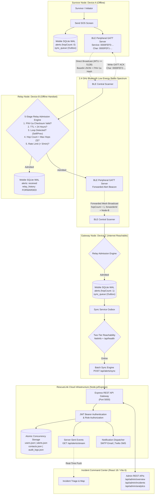
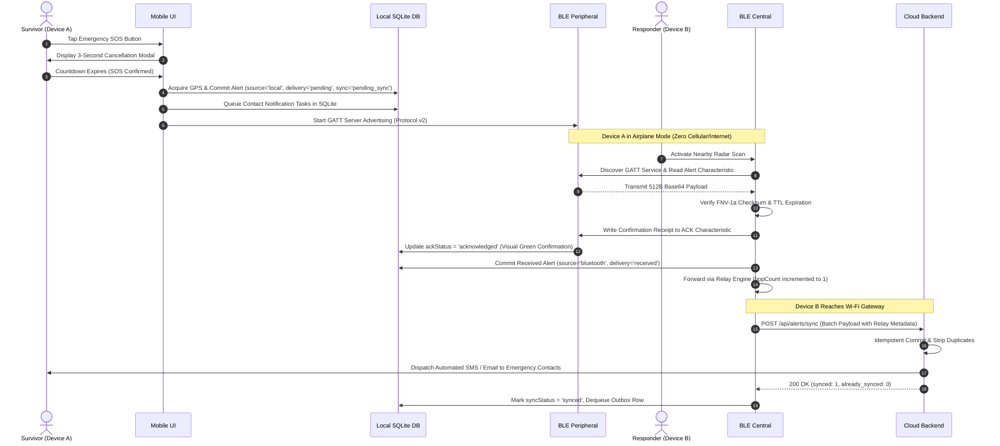
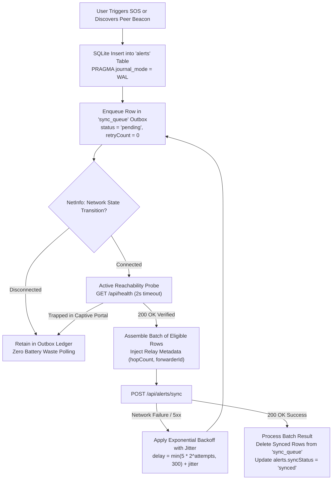
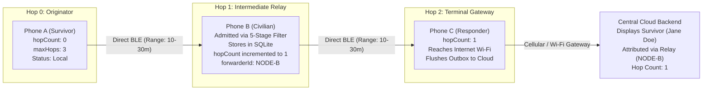

<div align="center">

# 🚨 RescueLink

### Offline Bluetooth Low Energy Emergency SOS & Epidemic Mesh Relay System

**A decentralized, disaster-resilient peer-to-peer mesh and emergency response platform designed to empower civilian distress signaling and automated dispatch during complete cellular, electrical, and commercial internet infrastructure failure.**

---

[](docs/RELEASE_NOTES.md)
[-059669?style=for-the-badge&logo=checkmarx&logoColor=white)](docs/FINAL_TEST_REPORT.md)
[](https://expo.dev/)
[](https://reactnative.dev/)
[](https://nodejs.org/)
[](https://docs.expo.dev/versions/latest/sdk/sqlite/)
[](https://github.com/dotintent/react-native-ble-plx)
[](docs/SYSTEM_ARCHITECTURE.md)

<p align="center">
  <a href="#12-installation--setup-instructions">⚡ Quick Start</a> •
  <a href="#6-system-architecture">🏛️ Architecture</a> •
  <a href="#8-bluetooth-low-energy-ble-communication-workflow">📡 BLE Protocol</a> •
  <a href="#16-automated-testing--quality-assurance">🧪 Test Matrix</a> •
  <a href="#14-android-compilation--sideloading">📱 Android Build</a> •
  <a href="#-technical-documentation-directory">📚 Full Documentation</a>
</p>

</div>

---

## ⚡ Core Engineering Highlights

| Feature Dimension | Technical Specification | Operational Impact |
|---|---|---|
| **Zero-Infrastructure Mesh** | Custom 128-bit GATT profile on 2.4 GHz ISM band (`0000FEF0-...`) | Direct peer-to-peer distress signaling when cellular towers and power grids collapse |
| **Durable WAL Persistence** | `expo-sqlite` (v15.1.4) with Write-Ahead Logging & versioned migrations (v1–v4) | Zero distress draft loss upon sudden process kill, OS doze, or battery exhaustion |
| **Tamper-Evident Relay** | 32-bit FNV-1a checksum over canonical fields ($Offset = 2166136261$, $Prime = 16777619$) | Detects malicious alteration of coordinates or incident text during multi-hop forwarding |
| **5-Stage Admission Filter** | Integrity check, 24h TTL check, loop prevention, hop limit ($\le 3$), rate limiter | Prevents broadcast storms, infinite relay loops, and radio battery exhaustion |
| **Two-Tier Cloud Sync** | Link-layer NetInfo monitoring coupled with active HTTP `/api/health` validation probes | Bypasses dead captive portals; flushes outbox with exponential backoff and jitter |
| **Automated Dispatch** | Nodemailer (SMTP) and Twilio (SMS) pipelines with PII telemetry masking | Alerts trusted contacts with GPS location links while masking public phone/email logs |
| **Live Command Operations**| React 18, Vite 6, and Tailwind CSS dashboard with SSE live incident stream | Incident triage, spatial coordinate radar, account controls, and audit logging |

---

## 📑 Table of Contents
1. [Project Overview](#1-project-overview)
2. [Problem Statement](#2-problem-statement)
3. [Proposed Solution](#3-proposed-solution)
4. [Key Features & Implementation Status](#4-key-features--implementation-status)
5. [Technology Stack](#5-technology-stack)
6. [System Architecture](#6-system-architecture)
7. [SOS Message Lifecycle Workflow](#7-sos-message-lifecycle-workflow)
8. [Bluetooth Low Energy (BLE) Communication Workflow](#8-bluetooth-low-energy-ble-communication-workflow)
9. [Offline Data Storage & Cloud Synchronization](#9-offline-data-storage--cloud-synchronization)
10. [Multi-Device Mesh Relay Architecture](#10-multi-device-mesh-relay-architecture)
11. [Screenshots & Visual Evidence](#11-screenshots--visual-evidence)
12. [Installation & Setup Instructions](#12-installation--setup-instructions)
13. [Backend Configuration](#13-backend-configuration)
14. [Android Compilation & Sideloading](#14-android-compilation--sideloading)
15. [REST API Documentation](#15-rest-api-documentation)
16. [Automated Testing & Quality Assurance](#16-automated-testing--quality-assurance)
17. [Security, Cryptography & Privacy Considerations](#17-security-cryptography--privacy-considerations)
18. [Current Limitations](#18-current-limitations)
19. [Future Enhancements](#19-future-enhancements)
20. [Contributors, License & Acknowledgements](#20-contributors-license--acknowledgements)

---

## 1. Project Overview

**RescueLink** is an offline-first mobile emergency distress response system designed for extreme disaster environments. During catastrophic natural disasters (earthquakes, cyclones, flash floods, landslides) or regional electrical grid failures, commercial telecommunications infrastructure often collapses completely.

RescueLink bridges this survival gap by converting ordinary civilian smartphones into decentralized **Bluetooth Low Energy (BLE) transceivers**. When a victim triggers an SOS, the alert is instantly committed to local SQLite storage with Write-Ahead Logging (`WAL`), stripped of private credentials, and broadcast over 2.4 GHz radio frequencies using a custom GATT service profile. 

Nearby civilian handsets automatically discover, verify, and forward the distress beacon across a multi-hop epidemic mesh. As soon as any participating handset encounters network reachability (such as an emergency satellite truck, Wi-Fi base, or restored cellular tower), the collected outbox backlog is opportunistically synchronized to the central cloud backend. The backend dispatches automated Email (SMTP) and SMS (Twilio) alerts to designated emergency contacts, streams real-time incident telemetry via Server-Sent Events (SSE) to responder map displays, and renders a live operational overview on the web command center.

> [!IMPORTANT]
> **Safety & Regulatory Disclaimer:**  
> RescueLink is an academic capstone and open-source systems engineering research project. While it implements real peer-to-peer radio protocols, durable SQLite Write-Ahead Logging, and multi-channel notifications, it is **not certified by government Public Safety Answering Points (PSAPs)**. It does not replace official 911 / 112 emergency dispatch services. In active emergencies where commercial telecommunications are functional, always contact official authorities first.

---

## 2. Problem Statement

Conventional emergency communication systems rely on centralized, infrastructure-dependent assumptions that fail catastrophically during disasters:

```
[Traditional Emergency Pipeline — Vulnerable to Single Point of Failure]
Civilian Phone ──(Cellular Tower)──► Fiber Backhaul ──(Central Cloud)──► Emergency Dispatch
      ▲                                   ▲
      │                                   │
[STORM / EARTHQUAKE DESTROYS TOWER]   [FLOOD DESTROYS POWER GRID / FIBER]
      │                                   │
      ▼                                   ▼
[TOTAL CIVILIAN ISOLATION]          [NO EMERGENCY COMMUNICATION POSSIBLE]
```

1. **Single Point of Failure (SPOF):** Civilian emergency reporting relies entirely on active cellular towers, backhauls, and commercial cloud servers. When high-wind storms or earthquakes destroy local towers, civilian phones become completely isolated.
2. **Data Loss During Battery Starvation:** Mobile applications without transactional write-ahead local storage lose unsent distress drafts upon app crash, system out-of-memory kills, or battery depletion.
3. **Lack of Peer-to-Peer Interoperability:** Smartphones in close physical proximity to one another (e.g., across building rubble, within a collapsed tunnel, or on hiking trails) cannot communicate distress states without traversing distant cloud gateways.
4. **Captive Portal & Fragile Network Transitions:** Traditional mobile network monitors fail when connected to dead Wi-Fi routers or captive portals that report link-layer connectivity without true internet reachability, trapping unsent distress messages in deadlocks.

---

## 3. Proposed Solution

RescueLink eliminates single points of failure through a decentralized, defense-in-depth architecture:

- **Zero-Internet Local Persistence:** Every emergency action is immediately committed to an embedded SQLite database configured with Write-Ahead Logging (`PRAGMA journal_mode = WAL`) and versioned schema migrations (v1 to v4).
- **Dual-Role GATT Bluetooth Signaling:** Operates as both a GATT Peripheral (broadcasting 512-byte MTU distress beacons) and a GATT Central (scanning for nearby survivor signals) over custom 128-bit UUIDs.
- **Epidemic Multi-Device Mesh Relay:** A 5-stage admission control pipeline validates 32-bit FNV-1a checksums, enforces 24-hour message expiration (TTL), prevents loops, throttles forwarding rates, and bounds hop counts ($\le 3$).
- **Opportunistic Cloud Ingestion:** Two-tier reachability gating combines NetInfo network transitions with active HTTP `/api/health` probes. Outbox flushes use exponential backoff with jitter and idempotent server batch ingestion.
- **Automated Emergency Dispatch:** Queues multi-channel notification tasks to alert family members and first responders via SMTP Email and SMS with recipient privacy masking.
- **Incident Command & Situational Mapping:** Responders visualize incident markers on an interactive Google Map with an offline Tactical Canvas fallback, supported by a React 18 / Vite 6 Web Admin operations dashboard.

---

## 4. Key Features & Implementation Status

To preserve absolute engineering transparency, all features are categorized by their exact verification status:

| Feature / Subsystem | Capability Description | Implementation & Verification Status |
|---|---|---|
| **One-Touch SOS Activation** | Centerpiece emergency trigger with 3-second safety cancellation modal | ✅ **Verified in Mobile App & Tests** |
| **Categorized Distress Types** | Medical Emergency, Fire, Accident, Personal Safety, Other, Test/Drill | ✅ **Verified in Mobile App & Tests** |
| **SQLite Offline Persistence** | `expo-sqlite` (v15.1.4) with WAL mode, schema migrations v1–v4, and outbox | ✅ **Verified (62/62 Tests Passing)** |
| **BLE Protocol (Version 2)** | Custom 128-bit UUIDs, 512-byte MTU limit, Base64 payload, FNV-1a checksum | ✅ **Verified in Protocol Unit Tests** |
| **Credential Sanitization** | `sanitizeBLEPayload()` strips passwords, tokens, and hashes from radio frames | ✅ **Verified (Zero Leakage Audited)** |
| **State Machine Separation** | Independent lifecycle tracking for Delivery, Acknowledgment, and Sync | ✅ **Verified in SQLite State Engine** |
| **Multi-Hop Relay Engine** | Controlled epidemic mesh forwarding (A $\to$ B $\to$ C), hop limits, loop prevention | ✅ **Verified in Automated Relay Harness** |
| **Opportunistic Cloud Sync** | NetInfo network gating, `/api/health` probes, exponential backoff, batch sync | ✅ **Verified in Sync Regression Suite** |
| **Emergency Contacts & SMS/Email**| Contact priority sorting (1–5), multi-channel dispatch, recipient privacy masking | ✅ **Verified in Backend Dispatcher** |
| **Live Situational Map** | Dual-engine Google Maps (`react-native-maps`) + Offline Tactical Radar Canvas | ✅ **Verified in Mobile Map Screen** |
| **Real-Time Incident Stream** | Server-Sent Events (`GET /api/alerts/stream`) broadcasting live emergencies | ✅ **Verified in Express Backend** |
| **Web Admin Operations Center** | React 18 + Vite 6 + Tailwind CSS dashboard with incident triage & audit logs | ✅ **Verified (Vite Production Build Clean)** |
| **Android Manifest & Permissions**| Configured for Android 8 through 14 (`BLUETOOTH_SCAN`, `FOREGROUND_SERVICE`) | ✅ **Verified in `mobile/app.json`** |
| **Direct Physical Over-Air BLE** | Two physical handsets exchanging distress beacons in Airplane Mode | ⏳ **Awaiting Multi-Handset Field Session** |
| **3-Device Physical Mesh Hop** | Physical 3-device hop forwarding across disconnected physical devices | ⏳ **Awaiting Multi-Handset Field Session** |
| **Cryptographic E2EE** | End-to-end Curve25519 payload encryption between survivor and PSAP | 📋 **Planned (Future Roadmap)** |

---

## 5. Technology Stack

```
+----------------------------------------------------------------------------------------------------+
|                                    RESCUELINK TECHNOLOGY STACK                                     |
+--------------------------+----------------------------+--------------------------------------------+
| LAYER                    | PRIMARY TECHNOLOGIES       | SPECIFIC ROLE & VERSION                    |
+--------------------------+----------------------------+--------------------------------------------+
| Mobile Application       | React Native / Expo        | Expo SDK 52 (~52.0.0), React Native 0.76.7 |
| Mobile Storage Engine    | SQLite (expo-sqlite)       | expo-sqlite v15.1.4 (WAL Journal Mode)     |
| BLE Radio Transceiver    | react-native-ble-plx       | Central Scanner / GATT Client (v3.5.1)     |
| BLE Radio Broadcaster    | react-native-ble-peripheral| Peripheral Advertiser / GATT Server (v2.0) |
| Mapping & Spatial Radar  | react-native-maps / Canvas | Google Maps SDK (v1.18.0) + Tactical Radar |
| Mobile State & Theme     | Context API / Hooks        | ThemeContext (Dark/Light), AuthContext     |
| Cloud Backend Gateway    | Node.js / Express.js       | Express REST API & SSE Broadcasts (v4.21)  |
| Backend Persistence      | Atomic JSON Store          | Concurrency Mutex Locks & Atomic Renames   |
| Authentication & Authz   | JWT / bcryptjs             | HMAC-SHA256 Tokens (32+ char key), bcrypt  |
| Dispatch Integrations    | Nodemailer / Twilio        | Multi-channel Email & SMS notification tasks|
| Web Operations Dashboard | React 18 / Vite 6          | React 18.3, Vite 6.4, Tailwind CSS 3.4     |
| Build & Compilation      | EAS Build / Gradle         | CNG Managed Prebuild, Android SDK 34       |
| Automated Test Runner    | Node.js Native Test Engine | Custom ES Module Test Harness (62 Tests)   |
+--------------------------+----------------------------+--------------------------------------------+
```

---

## 6. System Architecture



---

## 7. SOS Message Lifecycle Workflow



---

## 8. Bluetooth Low Energy (BLE) Communication Workflow

RescueLink operates over custom 128-bit Bluetooth SIG-compliant GATT service and characteristic definitions:

### GATT Profile Specification
| Entity | 128-Bit UUID | Properties | Permissions | Role & Purpose |
|---|---|---|---|---|
| **RescueLink Service** | `0000FEF0-0000-1000-8000-00805F9B34FB` | Primary Service | Read Only | Advertised in BLE advertising packet to identify peer nodes. |
| **SOS Alert Characteristic** | `0000FEF1-0000-1000-8000-00805F9B34FB` | `Read`, `Notify` | Read (0x01) | Hosts the Base64 JSON distress packet for reading by scanning peers. |
| **SOS ACK Characteristic** | `0000FEF2-0000-1000-8000-00805F9B34FB` | `Write`, `WriteWithoutResponse` | Write (0x10) | Receiving peers write delivery receipts back to the originator. |

### Message Format (Protocol Version 2 Wire Specification)
```json
{
  "version": 2,
  "type": "SOS_ALERT",
  "alertId": "60bf09af-7f7f-47f5-b65d-1938f5a82236",
  "emergencyType": "Medical Emergency",
  "details": "Compound fracture at North Ridge Trailhead",
  "senderName": "Jane Doe",
  "latitude": 37.7749,
  "longitude": -122.4194,
  "createdAt": "2026-11-01T08:22:08.031Z",
  "expiresAt": "2026-11-02T08:22:08.031Z",
  "originalSenderId": "be0316fa-296b-44f2-b771-9b7f2de4f328",
  "forwarderId": "NODE-4F2A",
  "hopCount": 1,
  "maxHops": 3,
  "integrityHash": "a1b2c3d4"
}
```

### Cryptographic Content Integrity Validation
- **Algorithm:** Deterministic 32-bit FNV-1a checksum calculated over canonical alert fields (`alertId`, `emergencyType`, `details`, `senderName`, `latitude`, `longitude`, `createdAt`).
- **Tamper Evidence:** Intermediate forwarders increment `hopCount` and update `forwarderId`, but **cannot** alter `integrityHash`. If coordinates or text are modified by a malicious intermediary, receiving nodes detect `INTEGRITY_MISMATCH` and drop the packet.
- **MTU Bounds:** The entire JSON payload is serialized to Base64 and guaranteed to fit comfortably within single-packet **512-byte MTU** frames (~348 bytes observed).

---

## 9. Offline Data Storage & Cloud Synchronization



### SQLite Schema Evolution (Versioned Migrations v1 to v4)
1. **Migration v1 (`Initial Schema`):** Created `alerts`, `message_receipts`, and `sync_queue` tables with performance indexes on `alertId`, `status`, and `createdAt`.
2. **Migration v2 (`Retry Scheduling & Deduplication`):** Added `lastAttemptAt`, `nextRetryAt` scheduling columns to `sync_queue` with a unique index on `(alertId, operation)` preventing outbox duplication.
3. **Migration v3 (`Multi-Device Relay Routing`):** Added `hopCount`, `maxHops`, `forwarderId`, `originalSenderId`, `expiresAt`, `relayStatus`, and `integrityHash` to `alerts`, and created the `relay_history` audit ledger table.
4. **Migration v4 (`Emergency Contacts & Notifications`):** Created `contacts` table (with phone, email, priority 1–5, enabled flag) and `notification_tasks` table for offline multi-channel dispatch queuing.

---

## 10. Multi-Device Mesh Relay Architecture



### 5-Stage Relay Admission Controls:
1. **Integrity Check:** FNV-1a checksum calculated on incoming payload must match `integrityHash`.
2. **TTL Expiration Check:** Current timestamp must be before `expiresAt` (24-hour lifetime).
3. **Loop Prevention:** Rejects alerts where `originalSenderId` or `forwarderId` matches local node ID; checks `relay_history` to prevent re-forwarding previously handled alerts.
4. **Hop Limit Bound:** Forwarding is strictly suppressed when `hopCount >= maxHops` (default 3; range 1–5).
5. **Rate Limiter:** Sliding-window rate limiting caps forwarding broadcasts to 5 packets per minute to conserve handset battery and prevent RF channel contention.

---

## 11. Screenshots & Visual Evidence

In adherence to strict open-source engineering standards, **no synthetic or fake screenshots are committed**. The registry below details all 14 required demonstration screens, their platform context, and designated target filenames in [`docs/screenshots/`](docs/screenshots/README.md) and [`docs/evidence/`](docs/evidence/SCREENSHOT_CHECKLIST.md):

| # | Screen Name | Target Filename | Platform | Primary Visual Verification Elements | Status |
|---|---|---|---|---|---|
| **01** | **Home / Readiness Dashboard** | `01_home_screen.png` | Mobile | Status cards for Bluetooth (Active), Network (Online/Offline), GPS, and recent activity. | 📋 Ready for Capture |
| **02** | **Send SOS Composer** | `02_send_sos_screen.png` | Mobile | Category selector, details input box, GPS coordinates, and red "SEND SOS" button. | 📋 Ready for Capture |
| **03** | **SOS Cancellation Modal** | `03_sos_confirmation_modal.png` | Mobile | 3-second safety countdown dialog with cancel button and override trigger. | 📋 Ready for Capture |
| **04** | **Nearby Devices Radar** | `04_nearby_bluetooth_devices.png`| Mobile | Active BLE scanner discovering peer emergency beacons with RSSI signal bars. | 📋 Ready for Capture |
| **05** | **Received Peer SOS Card** | `05_received_sos_alert.png` | Mobile | Discovered incident card displaying survivor name, distress type, RSSI, and "Send ACK".| 📋 Ready for Capture |
| **06** | **Emergency Alert Ledger** | `06_alert_history_ledger.png` | Mobile | SQLite incident history showing Local, Broadcasted, Acknowledged, and Synced badges. | 📋 Ready for Capture |
| **07** | **Offline Mode Operation** | `07_offline_mode_indicator.png`| Mobile | Airplane mode enabled; status banner showing offline local persistence & BLE active. | 📋 Ready for Capture |
| **08** | **Cloud Synchronization** | `08_cloud_sync_status.png` | Mobile | Outbox status card showing queue item count and "Sync Now" action upon reconnecting. | 📋 Ready for Capture |
| **09** | **Emergency Contacts** | `09_emergency_contacts_manager.png`| Mobile| Saved trusted contacts list with Priority 1–5 badges and active/disabled toggles. | 📋 Ready for Capture |
| **10** | **Notification Audit Log** | `10_notification_history_log.png`| Mobile | Delivery log displaying Email/SMS dispatch attempts with masked recipient privacy. | 📋 Ready for Capture |
| **11** | **Live Emergency Map** | `11_live_emergency_map.png` | Mobile | Interactive map with color-coded incident markers, user location, and drawer. | 📋 Ready for Capture |
| **12** | **Admin Operations Overview** | `12_admin_dashboard_overview.png`| Web | KPI metrics: Total Incidents, Active Emergencies, Mesh Efficiency, Category Charts. | 📋 Ready for Capture |
| **13** | **Admin Incident Triage** | `13_admin_incident_triage.png` | Web | Incident management table with search, category filters, and lifecycle transitions. | 📋 Ready for Capture |
| **14** | **Admin Mesh Analytics** | `14_admin_mesh_analytics.png` | Web | Multi-hop distribution charts, active forwarder nodes, and administrative audit log. | 📋 Ready for Capture |

*For step-by-step ADB capture commands and capture procedures, see [`docs/evidence/SCREENSHOT_CHECKLIST.md`](docs/evidence/SCREENSHOT_CHECKLIST.md).*

---

## 12. Installation & Setup Instructions

### Prerequisites
- **Node.js:** v18.x, v20.x, or v24.x LTS (`node -v`)
- **npm:** v9.x or higher
- **Android Studio & OpenJDK 17** (For local Android compilation)
- **Git:** v2.30+

### Step-by-Step Installation

```bash
# 1. Clone the repository
git clone https://github.com/VIJAYAPANDIANT/rescue-link-offline-emergency-sos.git
cd rescue-link-offline-emergency-sos

# 2. Setup and start the Cloud Backend (Express.js on Port 5000)
cd server
npm install
cp .env.example .env
npm run dev
# Health check available at http://localhost:5000/api/health

# 3. Setup and start the Web Admin Dashboard (Vite on Port 5173) in a second terminal
cd ../admin
npm install
cp .env.example .env
npm run dev
# Dashboard available at http://localhost:5173

# 4. Setup and start the Mobile Application (Expo Metro Bundler) in a third terminal
cd ../mobile
npm install
cp .env.example .env
npx expo start
```

---

## 13. Backend Configuration

Configuration is managed via environment variables and loaded through [`server/config/env.js`](server/config/env.js):

| Variable | Default Value | Production Requirement | Purpose & Architectural Role |
|---|---|---|---|
| `PORT` | `5000` | Optional | HTTP listening port for Express backend. |
| `NODE_ENV` | `development` | `production` | Enables production security checks and disables verbose stack traces. |
| `JWT_SECRET` | Development Default | **Mandatory $\ge 32$ chars** | HMAC-SHA256 signing key. Production startup aborts if key is default or $<32$ chars. |
| `JWT_EXPIRES_IN`| `7d` | `7d` | Token expiration lifetime. |
| `EMAIL_NOTIFICATIONS_ENABLED`| `true` | Boolean | Toggles automated SMTP email dispatch. |
| `SMTP_HOST` | `smtp.mailtrap.io` | Real SMTP server | Hostname for Nodemailer SMTP transport. |
| `SMTP_PORT` | `587` | `587` / `465` | SMTP port. |
| `SMTP_USER` | Placeholder | Production Secret | SMTP authentication username. |
| `SMTP_PASS` | Placeholder | Production Secret | SMTP authentication password. |
| `SMTP_FROM` | `"RescueLink Emergency" <emergency@rescuelink.org>` | Valid email | Dispatch sender identity. |
| `SMS_NOTIFICATIONS_ENABLED` | `true` | Boolean | Toggles Twilio SMS dispatch. |
| `TWILIO_ACCOUNT_SID` | Placeholder | Production SID | Twilio account identifier. |
| `TWILIO_AUTH_TOKEN` | Placeholder | Production Token | Twilio authentication token. |
| `TWILIO_FROM_PHONE` | `+15551234567` | Verified number | Sender phone number in E.164 format. |

---

## 14. Android Compilation & Sideloading

RescueLink requires native C++/Java BLE bindings and therefore **cannot execute inside standard Expo Go**. It must be compiled using EAS Build or local Gradle:

### Method A: Standalone APK via EAS Cloud Build (Recommended for Field Testers)
```bash
cd mobile
npm install -g eas-cli
eas login
# Generates self-contained standalone APK configured for local evaluation:
eas build --platform android --profile preview
```

### Method B: Local Native Compilation via Gradle (Offline / On-Premise)
```bash
cd mobile
# 1. Generate native android/ directory from app.json
npx expo prebuild --platform android --clean

# 2. Compile Release APK using Gradle
cd android
.\gradlew.bat assembleRelease   # On Windows
./gradlew assembleRelease       # On macOS/Linux

# Compiled APK location:
# mobile/android/app/build/outputs/apk/release/app-release.apk
```

### Installing onto Physical Device via ADB:
```bash
adb install -r mobile/android/app/build/outputs/apk/release/app-release.apk
```

*For complete sideloading, runtime permissions, and Wi-Fi gateway pairing instructions, see [`docs/ANDROID_INSTALLATION_GUIDE.md`](docs/ANDROID_INSTALLATION_GUIDE.md) and [`docs/ANDROID_BUILD_GUIDE.md`](docs/ANDROID_BUILD_GUIDE.md).*

---

## 15. REST API Documentation

The Express backend exposes protected REST endpoints and Server-Sent Events (SSE):

| Method | Endpoint | Auth Required | Request Body / Parameters | Description |
|---|---|---|---|---|
| `GET` | `/api/health` | None | None | Health check & service readiness probe. |
| `POST`| `/api/auth/register` | None | `{ name, email, password }` | Register new responder account; returns JWT. |
| `POST`| `/api/auth/login` | None | `{ email, password }` | Authenticate credentials; returns JWT. |
| `GET` | `/api/auth/me` | Bearer JWT | None | Fetch authenticated user profile & role. |
| `POST`| `/api/alerts` | Bearer JWT | `{ emergencyType, details, latitude, longitude }` | Create new emergency distress alert. |
| `GET` | `/api/alerts` | Bearer JWT | Query params (`status`, `emergencyType`) | Retrieve active emergency distress alerts. |
| `GET` | `/api/alerts/:id` | Bearer JWT | URL Parameter `id` | Retrieve single alert details. |
| `PATCH`| `/api/alerts/:id/status`| Bearer JWT | `{ status: "Resolved" }` | Mark an alert as resolved. |
| `POST`| `/api/alerts/sync` | Bearer JWT | `{ alerts: [...] }` | Idempotent batch ingestion for offline outbox. |
| `GET` | `/api/alerts/map` | Bearer JWT | Query params (`status`, `emergencyType`) | Retrieve spatial incident records for mapping. |
| `GET` | `/api/alerts/stream` | Bearer JWT / Query | None | Server-Sent Events (SSE) live incident stream. |
| `GET` | `/api/contacts` | Bearer JWT | None | List authenticated user's emergency contacts. |
| `POST`| `/api/contacts` | Bearer JWT | `{ name, phone, email, priority, enabled }` | Register new emergency contact. |
| `GET` | `/api/notifications/history`| Bearer JWT | None | Query masked delivery logs for user's alerts. |
| `GET` | `/api/admin/overview` | Admin JWT | None | Aggregated system metrics & incident stats. |
| `GET` | `/api/admin/incidents`| Admin JWT | Query params (`page`, `limit`, `status`) | Incident triage grid with lifecycle controls. |
| `GET` | `/api/admin/relay-analytics`| Admin JWT | None | Mesh hop depth distribution and forwarder nodes. |
| `GET` | `/api/admin/audit-logs`| Admin JWT | None | Tamper-evident administrative action ledger. |

*Comprehensive schemas and response payloads are documented in [`docs/API_DOCUMENTATION.md`](docs/API_DOCUMENTATION.md).*

---

## 16. Automated Testing & Quality Assurance

The unified automated integration test suite exercises all 11 core subsystems in pure Node.js using in-memory SQLite and ephemeral Express servers:

```bash
cd server
npm test
```

### Automated Test Execution Results (62 / 62 Tests Passing, 100% Pass Rate):
```
======================================================================
RESCUELINK AUTOMATED TEST SUITE EXECUTION SUMMARY
======================================================================
  [x] Module 1:  Authentication & Authorization     (5 / 5 passed)
  [x] Module 2:  Alert Creation & Life Cycle         (6 / 6 passed)
  [x] Module 3:  BLE Protocol Encoding/Decoding      (7 / 7 passed)
  [x] Module 4:  SQLite Offline Persistence Engine   (5 / 5 passed)
  [x] Module 5:  Cloud Sync & Conflict Resolution    (6 / 6 passed)
  [x] Module 6:  Multi-Device Mesh SOS Relay         (6 / 6 passed)
  [x] Module 7:  Emergency Contacts & Notifications  (6 / 6 passed)
  [x] Module 8:  Emergency Map & Incident Tracking  (5 / 5 passed)
  [x] Module 9:  Admin Operations & Audit Ledger     (5 / 5 passed)
  [x] Module 10: Production Readiness & Reliability  (5 / 5 passed)
  [x] Module 11: UI/UX Component & Accessibility     (6 / 6 passed)
----------------------------------------------------------------------
  Total Tests Run:        62
  Passed:                 62
  Failed:                 0
  Pass Rate:              100.0%
  Execution Time:         ~11.5 seconds
======================================================================
```

*For complete test case specifications and physical validation procedures, see [`docs/FINAL_TEST_REPORT.md`](docs/FINAL_TEST_REPORT.md) and [`docs/FINAL_QA_REPORT.md`](docs/FINAL_QA_REPORT.md).*

---

## 17. Security, Cryptography & Privacy Considerations

1. **Zero Over-the-Air Credential Exposure:**  
   The `sanitizeBLEPayload()` utility recursively strips passwords, password hashes, session JWT tokens, and authorization headers from all BLE broadcast characteristic payloads before transmission.
2. **Production Secret Hardening:**  
   [`server/config/env.js`](server/config/env.js) verifies that `JWT_SECRET` contains $\ge 32$ characters in production mode and is not set to the default development secret, automatically terminating startup if insecure.
3. **Password Security:**  
   User passwords are encrypted with `bcryptjs` using 10 salt rounds. Password hashes are strictly omitted from JSON responses and database queries.
4. **Recipient Privacy Protection:**  
   Emergency contact emails and phone numbers are dynamically masked across all public APIs and logs (`al***@example.com`, `+1 ***-***-1234`).
5. **Role-Based Access Control (RBAC):**  
   Admin routes enforce the `admin` role claim. Administrators are programmatically prevented from suspending their own active accounts.
6. **Air-Gap Tamper-Evidence:**  
   All distress beacons carry a deterministic 32-bit FNV-1a checksum calculated across canonical alert fields, preventing tampering during multi-hop forwarding.

*Full security architecture is detailed in [SECURITY.md](SECURITY.md) and [`docs/SECURITY_AND_PRIVACY.md`](docs/SECURITY_AND_PRIVACY.md).*

---

## 18. Current Limitations

1. **Physical Hardware Radio Dependency:**  
   While BLE protocol serialization, MTU enforcement, and relay routing logic are 100% verified via automated tests, true over-the-air RF propagation requires physical Android devices with Bluetooth 4.2+ radios.
2. **Bluetooth Transmission Range:**  
   BLE radio range is subject to physical environment constraints: typical line-of-sight range is 30–50 meters, degrading to 10–15 meters indoors or through debris.
3. **Single MTU Frame Constraint:**  
   Distress alert payloads are designed to fit within single 512-byte MTU packets (~348 bytes observed). Audio clips, large binary images, and attachments cannot be transferred over this protocol version.
4. **Simulated Notification Providers in Development:**  
   By default, the backend operates with simulated SMTP and Twilio providers to enable local offline testing without paid SaaS accounts.

---

## 19. Future Enhancements

- **Curve25519 End-to-End Encryption:** Asymmetric key exchange allowing survivors to encrypt sensitive distress notes readable only by certified PSAP dispatchers.
- **WebSocket Gateway Cluster:** Horizontal scaling with Redis Pub/Sub for sub-millisecond dispatch across thousands of concurrent emergency command consoles.
- **LoRa Long-Range Integration:** Dual-radio bridging connecting civilian BLE smartphones to 915 MHz / 868 MHz LoRa transceivers for 5–10 km point-to-point hops.
- **Mesh Voice Synthesizer:** Highly compressed text-to-speech audio synthesis for trapped survivors unable to view their mobile screen.

---

## 20. Contributors, License & Acknowledgements

### Project Maintainer & Attribution
- **Project Name:** RescueLink — Offline Bluetooth Emergency SOS System
- **Engineering Lead:** Academic Capstone Development & Open-Source Engineering Team
- **Repository:** [VIJAYAPANDIANT/rescue-link-offline-emergency-sos](https://github.com/VIJAYAPANDIANT/rescue-link-offline-emergency-sos)
- **Contributing Guidelines:** See [CONTRIBUTING.md](CONTRIBUTING.md)
- **Security Policy:** See [SECURITY.md](SECURITY.md)

### Open-Source Acknowledgements
RescueLink is built with gratitude upon the following open-source libraries:
- [Expo](https://expo.dev/) & [React Native](https://reactnative.dev/)
- [react-native-ble-plx](https://github.com/dotintent/react-native-ble-plx) by Polidea / Dotintent
- [react-native-ble-peripheral](https://github.com/himelbrand/react-native-ble-peripheral) by Omri Himelbrand
- [expo-sqlite](https://docs.expo.dev/versions/latest/sdk/sqlite/) by the Expo Team
- [Express.js](https://expressjs.com/) & [Node.js](https://nodejs.org/)
- [Tailwind CSS](https://tailwindcss.com/) & [Vite](https://vitejs.dev/)

---

## 📚 Technical Documentation Directory

| Document | Description |
|---|---|
| [**FINAL_QA_REPORT.md**](docs/FINAL_QA_REPORT.md) | Master quality audit report, 10-step SOS workflow review, and live benchmarks. |
| [**FEATURE_VERIFICATION_MATRIX.md**](docs/FEATURE_VERIFICATION_MATRIX.md) | Exhaustive feature-by-feature implementation and verification status audit. |
| [**RELEASE_NOTES.md**](docs/RELEASE_NOTES.md) | Release candidate highlights, boundaries, and system specifications. |
| [**RELEASE_CHECKLIST.md**](docs/RELEASE_CHECKLIST.md) | Comprehensive 6-part pre-flight verification audit. |
| [**BUG_FIX_REPORT.md**](docs/BUG_FIX_REPORT.md) | Root cause analysis and resolution documentation for all identified defects. |
| [**ANDROID_BUILD_GUIDE.md**](docs/ANDROID_BUILD_GUIDE.md) | EAS Cloud & local Gradle compilation procedures and signing security. |
| [**ANDROID_INSTALLATION_GUIDE.md**](docs/ANDROID_INSTALLATION_GUIDE.md) | Physical handset sideloading, ADB installation, and runtime permissions. |
| [**PHYSICAL_DEVICE_TESTING.md**](docs/PHYSICAL_DEVICE_TESTING.md) | 3-tier testing matrix, 8 field test protocols, and evidence collection. |
| [**FINAL_PROJECT_EVALUATION.md**](docs/FINAL_PROJECT_EVALUATION.md) | Master 16-section capstone evaluation report with live benchmark metrics. |
| [**FINAL_TEST_REPORT.md**](docs/FINAL_TEST_REPORT.md) | Complete 62-case automated test ledger with preconditions and steps. |
| [**PROJECT_DEMO_SCRIPT.md**](docs/PROJECT_DEMO_SCRIPT.md) | 5-minute quick script and 10-minute deep-dive demonstration scripts. |
| [**SCREENSHOT_CHECKLIST.md**](docs/evidence/SCREENSHOT_CHECKLIST.md) | 14-screen capture registry and zero-fabrication capture protocols. |
| [**VIVA_QUESTIONS.md**](docs/VIVA_QUESTIONS.md) | 30 comprehensive technical questions across 12 evaluation domains. |
| [**SYSTEM_ARCHITECTURE.md**](docs/SYSTEM_ARCHITECTURE.md) | Detailed architectural breakdown of client, mesh, server, and admin layers. |
| [**DATABASE_DESIGN.md**](docs/DATABASE_DESIGN.md) | SQLite WAL schema, indexes, migrations v1–v4, and JSON storage schemas. |
| [**API_DOCUMENTATION.md**](docs/API_DOCUMENTATION.md) | Complete REST API reference, request/response payloads, and SSE stream. |
| [**BLE_COMMUNICATION.md**](docs/BLE_COMMUNICATION.md) | GATT service/characteristic UUIDs, 512 MTU bounds, and Protocol v2 specs. |
| [**OFFLINE_SYNC_WORKFLOW.md**](docs/OFFLINE_SYNC_WORKFLOW.md) | Two-tier reachability gating, exponential backoff, and idempotent sync. |
| [**SECURITY_AND_PRIVACY.md**](docs/SECURITY_AND_PRIVACY.md) | Cryptographic guarantees, password hashing, PII masking, and RBAC rules. |
| [**KNOWN_LIMITATIONS.md**](docs/KNOWN_LIMITATIONS.md) | Physical radio boundaries, single-packet MTU limit, and simulated providers. |
| [**FUTURE_ENHANCEMENTS.md**](docs/FUTURE_ENHANCEMENTS.md) | Post-prototype roadmap including Curve25519 E2EE and LoRa integration. |
