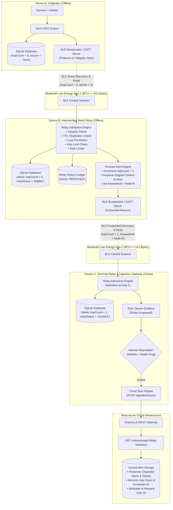
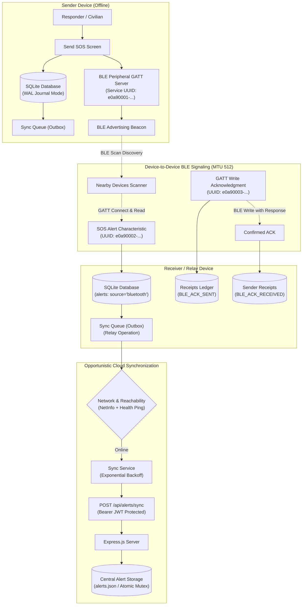
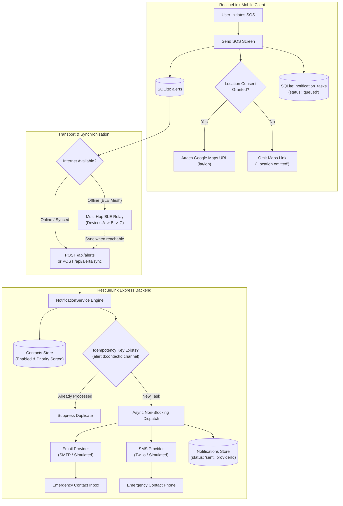
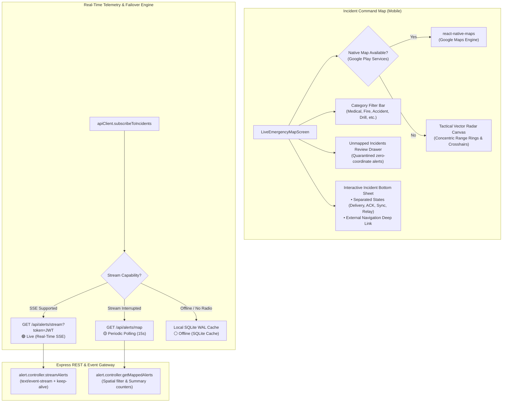
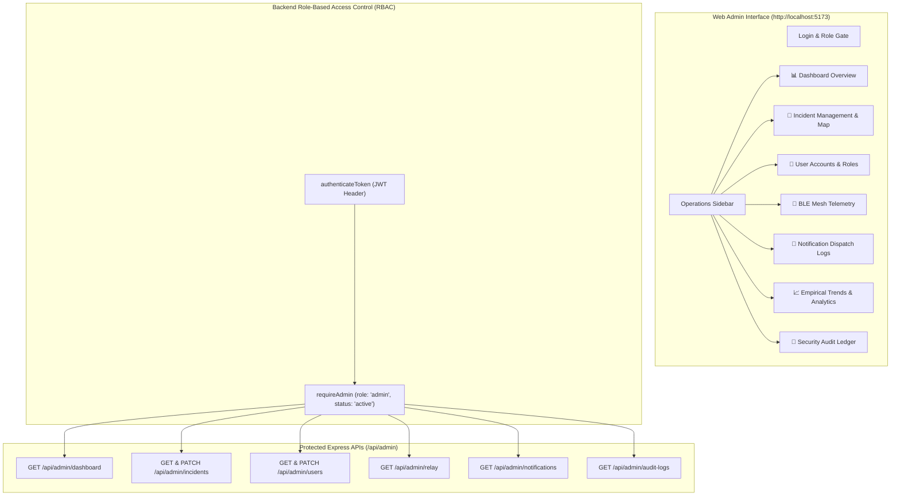

# RescueLink — Offline Bluetooth Emergency SOS System

[](https://opensource.org/licenses/MIT)
[](https://nodejs.org/)
[](https://expo.dev/)
[](https://docs.expo.dev/versions/latest/sdk/sqlite/)
[](https://github.com/dotintent/react-native-ble-plx)

> **Major Project — Comprehensive Staged Implementation (Steps 1–11 Completed: Admin Dashboard, Emergency Monitoring & Analytics)**

---

## 🚨 Project Overview

**RescueLink** is a mission-critical, offline-first mobile emergency distress response system. During major natural disasters (earthquakes, cyclones, floods), wilderness expeditions, or catastrophic power grid collapse, cellular infrastructure and commercial internet services often fail entirely.

RescueLink bridges this communication gap through a **multi-device Bluetooth Low Energy (BLE) epidemic relay network** combined with **local SQLite offline persistence**, an automated **multi-channel emergency contact notification pipeline**, a **live interactive emergency map with real-time situational tracking**, and a **dedicated web-based Admin Command Dashboard & Analytics Suite**. When a survivor with no cellular signal broadcasts an SOS, nearby devices automatically receive, store, and can forward the distress alert across multiple hops. Once any participating node in the mesh regains cellular or Wi-Fi connectivity, all collected emergency records are opportunistically synchronized with the central rescue cloud backend, which automatically dispatches distress alerts via Email (SMTP) and SMS (Twilio) to designated emergency contacts, streams active incidents to field responders' live maps in real time, and renders live situational telemetry on the administrator command dashboard.

---

## ⚠️ Important Safety & Ethical Notice

> [!IMPORTANT]
> **RescueLink is an academic engineering project.**
> - While RescueLink implements real Bluetooth Low Energy peer transmission, genuine GATT message exchange, multi-hop relay forwarding, durable offline SQLite storage, multi-channel notifications, live incident mapping, and administrative oversight, it is **NOT certified by government public safety answering points (PSAPs)**.
> - This software is **NOT a replacement for certified 911, 112, or local emergency dispatch hotlines**.
> - In an active emergency where cellular networks or landlines are available, always contact official emergency services immediately.

---

## 🛠️ Technology Stack

| Layer | Technology | Purpose | Implementation Status |
|---|---|---|---|
| **Mobile Client** | React Native (JavaScript) + Expo SDK 52 | Cross-platform emergency UI design system | ✅ Completed (Step 1) |
| **Backend API** | Node.js + Express.js | Central REST API server & cloud ingestion | ✅ Completed (Steps 1–3) |
| **Security** | JSON Web Tokens (JWT) + bcrypt | Authentication, password hashing & profile security | ✅ Completed (Step 2) |
| **Alert Management** | Atomic JSON File Storage + REST API | Concurrency-safe incident management & validation | ✅ Completed (Step 3) |
| **BLE Central (Receiver)** | `react-native-ble-plx` | Scanning, GATT service discovery, SOS message reading | ✅ Completed (Step 4) |
| **BLE Peripheral (Sender)** | `react-native-ble-peripheral` | Custom GATT server hosting & beacon advertising | ✅ Completed (Step 4) |
| **Local Storage** | `expo-sqlite` (v15.1.4) | Offline WAL persistence, schema migrations (v1-v4), outbox & contacts | ✅ Completed (Steps 5, 8 & 9) |
| **Connectivity & NetInfo** | `@react-native-community/netinfo` (v11.4.1) | Live network monitoring & internet reachability verification | ✅ Completed (Step 6) |
| **Cloud Synchronization** | Opportunistic Sync Engine + Express REST | Outbox batch processing, exponential backoff, & BLE relay attribution | ✅ Completed (Step 6) |
| **System Integration** | End-to-End Relay + Security Audit + 57 Tests | Full mesh-to-cloud relay, dynamic gateway config & test suite | ✅ Completed (Step 7) |
| **Multi-Device SOS Relay** | Controlled BLE Epidemic Mesh Forwarding | Multi-hop routing (A -> B -> C), hop limits, tamper hash, TTL & rate limits | ✅ Completed (Step 8) |
| **Emergency Contacts & Notifications**| SMTP Email + Twilio SMS + SQLite Tasks | Multi-channel dispatch, priority sorting, location consent gate & idempotency | ✅ Completed (Step 9) |
| **Live Map & Situational Tracking** | `react-native-maps` (v1.18.0) + Tactical Canvas + SSE | Dual-engine interactive map, real-time SSE stream, & offline GPS radar | ✅ Completed (Step 10) |
| **Admin Dashboard & Analytics** | React + Vite + Tailwind CSS | Operations command center, incident triage, user management & telemetry | ✅ Completed (Step 11) |
| **Cryptographic E2EE** | Curve25519 / X25519 Asymmetric Encryption | End-to-end encryption of sensitive characteristic details | ⏳ Planned (Next Phase) |

---

## 📁 Repository Structure

```text
c:\Offline Emergency SOS/
├── mobile/
│   ├── App.js                         # Root React Native application entry
│   ├── app.json                       # Expo configuration, permissions & plugins
│   ├── babel.config.js                # Babel compilation config
│   ├── package.json                   # Mobile dependencies & scripts
│   ├── .env.example                   # Mobile environment template (EXPO_PUBLIC_API_URL)
│   ├── assets/                        # Adaptive icons, splash, & metadata assets
│   └── src/
│       ├── components/                # Reusable UI component library
│       │   ├── SOSButton.js           # Animated pulsing circular emergency trigger
│       │   ├── StatusCard.js          # Color-coded subsystem status card
│       │   ├── EmergencyTypeSelector.js # Category picker (Medical, Fire, Accident, etc.)
│       │   ├── PrimaryButton.js       # Accessible buttons (Danger, Outline, Success, Warning)
│       │   ├── EmptyState.js          # Zero-data state with actions
│       │   ├── EmergencyMapView.js    # Step 10: Dual-engine Map (react-native-maps + Tactical Radar fallback)
│       │   └── index.js
│       ├── screens/                   # Core application screens
│       │   ├── HomeScreen.js          # Emergency dashboard with live subsystem sensors
│       │   ├── SendSOSScreen.js       # SOS composer, offline draft, BLE broadcaster & contacts preview
│       │   ├── NearbyDevicesScreen.js # BLE receiver, SOS reader, ACK sender, & relay forwarder
│       │   ├── EmergencyHistoryScreen.js # SQLite-backed persistent ledger & mesh relay hub
│       │   ├── LiveEmergencyMapScreen.js # Step 10: Live incident tracking map, SSE telemetry & deep link
│       │   ├── EmergencyContactsScreen.js # Step 9: Emergency contacts manager (Priority, Add/Edit)
│       │   ├── NotificationHistoryScreen.js # Step 9: Multi-channel delivery logs & test gateway
│       │   ├── LoginScreen.js         # Responder JWT authentication
│       │   ├── RegisterScreen.js      # Account registration screen
│       │   ├── ProfileScreen.js       # Mesh relay settings, anonymous Node ID & gateway config
│       │   └── index.js
│       ├── navigation/                # Mobile navigation system
│       │   ├── AppNavigator.js        # Fluid screen router & emergency bottom tabs
│       │   └── index.js
│       ├── context/
│       │   └── AuthContext.js         # JWT auth state provider & AsyncStorage sync
│       ├── database/                  # SQLite Persistence Subsystem (Steps 5, 6, 8 & 9)
│       │   ├── database.js            # SQLite connection, PRAGMA WAL, & lifecycle
│       │   ├── migrations.js          # Versioned schema migrations runner (v1 to v4)
│       │   ├── alertRepository.js     # SOS alert CRUD, upsert, and multi-source queries
│       │   ├── receiptRepository.js   # Message delivery & ACK receipts with atomic transactions
│       │   ├── syncQueueRepository.js # Offline outbox queue with deduplication & retry backoff
│       │   ├── relayRepository.js     # Step 8 Relay history audit log & aggregate stats
│       │   ├── contactRepository.js   # Step 9 SQLite storage for emergency contacts
│       │   ├── notificationRepository.js # Step 9 SQLite tracking for notification tasks
│       │   └── index.js               # Central database export
│       ├── services/                  # Business & hardware services
│       │   ├── bluetooth/             # Bluetooth Low Energy Subsystem (Step 4)
│       │   │   ├── bleConstants.js    # Custom 128-bit UUIDs, protocol limits, relay parameters
│       │   │   ├── bleProtocol.js     # Version 2 protocol serializer, tamper hash, & forward builder
│       │   │   ├── blePermissions.js  # Android 6–14+ dynamic runtime permissions
│       │   │   ├── bleManagerModule.js# Safe native BLE bridge resolver
│       │   │   ├── bleCentralService.js# Receiver scanning, connect, read, ACK write
│       │   │   ├── blePeripheralService.js# Sender GATT server & advertising beacon
│       │   │   └── bluetoothService.js# Unified Central & Peripheral coordinator
│       │   ├── relay/                 # Multi-Device Mesh Relay Subsystem (Step 8)
│       │   │   ├── relaySettings.js   # Relay enable toggle, max hops, anonymous node ID
│       │   │   └── relayService.js    # Multi-hop admission pipeline, loop prevention & forward engine
│       │   ├── notification/          # Step 9 Notification Queue Subsystem
│       │   │   └── notificationQueueService.js # Offline local task enqueuing & cloud sync
│       │   ├── network/               # Network Connectivity Subsystem (Step 6)
│       │   │   └── networkService.js  # Live NetInfo monitor & reachability checker
│       │   ├── api/
│       │   │   └── apiClient.js       # REST client with syncAlerts & contacts API
│       │   └── sync/                  # Cloud Synchronization Engine (Step 6)
│       │       └── syncService.js     # Opportunistic outbox sync & exponential backoff
│       └── utils/
│           ├── constants.js           # Emergency categories, status & disclaimers
│           ├── theme.js               # Emergency color palette, spacing & typography
│           └── helpers.js             # Formatter functions (coords, dates, IDs)
├── admin/                             # Step 11: Web Admin Dashboard (React + Vite + Tailwind CSS)
│   ├── index.html                     # Web entry point
│   ├── package.json                   # Dashboard dependencies & scripts
│   ├── vite.config.js                 # Vite proxy & build configuration
│   ├── tailwind.config.js             # Emergency command center theme
│   ├── src/
│   │   ├── main.jsx                   # Application bootstrap & auth context mount
│   │   ├── App.jsx                    # Core shell, sidebar router & tab navigation
│   │   ├── index.css                  # Custom styling & scrollbars
│   │   ├── api/
│   │   │   └── adminApi.js            # Admin REST client for /api/admin & /api/auth
│   │   ├── context/
│   │   │   └── AdminAuthContext.jsx   # Admin authentication session & token storage
│   │   ├── components/                # Reusable dashboard UI components
│   │   │   ├── Sidebar.jsx            # Dark operations navigation sidebar
│   │   │   ├── Header.jsx             # Top bar with gateway heartbeat & refresh
│   │   │   ├── MetricCard.jsx         # Telemetry KPI cards with trends
│   │   │   ├── StatusBadge.jsx        # Standardized color-coded status badges
│   │   │   ├── InteractiveMap.jsx     # Spatial radar canvas for mapped incidents
│   │   │   ├── Modal.jsx              # Accessible modal dialog
│   │   │   ├── Pagination.jsx         # Paginated page control
│   │   │   ├── EmptyState.jsx         # Truthful zero-record presentation
│   │   │   └── Icons.jsx              # Vector SVG icons
│   │   └── views/                     # Full-page administration modules
│   │       ├── LoginView.jsx          # Admin credentials entry & validation
│   │       ├── OverviewView.jsx       # Operational metrics, sync health & charts
│   │       ├── IncidentsView.jsx      # Triage table, spatial canvas, & status transitions
│   │       ├── UsersView.jsx          # Account management, suspension & role updates
│   │       ├── RelayView.jsx          # BLE mesh forwarding telemetry & hop depth
│   │       ├── NotificationsView.jsx  # Multi-channel delivery audits & masked recipients
│   │       ├── AnalyticsView.jsx      # Daily broadcast cadence & category breakdown
│   │       └── AuditLogsView.jsx      # Tamper-evident administrative action ledger
├── server/
│   ├── config/
│   │   └── env.js                     # Validated environment loader with notification configs
│   ├── scripts/
│   │   └── create-admin.js            # Step 11: Safe initial administrator setup CLI
│   ├── validators/                    # Request payload validation
│   │   └── contact.validator.js       # Step 9 Phone, email, name, & priority validation
│   ├── controllers/
│   │   ├── health.controller.js       # Health check controller
│   │   ├── auth.controller.js         # Register, Login, & Profile controllers
│   │   ├── alert.controller.js        # Alert CRUD, status, & validation controllers
│   │   ├── contact.controller.js      # Step 9 Emergency contacts CRUD controller
│   │   ├── notification.controller.js # Step 9 Notification history & test controller
│   │   └── admin.controller.js        # Step 11: Dashboard, incident triage & user management
│   ├── middleware/
│   │   ├── auth.middleware.js         # JWT verification, requireAdmin role check & status
│   │   ├── error.middleware.js        # Central Express error handler
│   │   └── notFound.middleware.js     # Standardized 404 handler
│   ├── data/                          # Atomic Server Persistence
│   │   ├── users.json                 # Thread-safe atomic JSON user store (with roles & status)
│   │   ├── alerts.json                # Concurrency-locked atomic JSON alert store
│   │   ├── contacts.json              # Step 9 Thread-safe atomic contacts store
│   │   ├── notifications.json         # Step 9 Delivery audit logs store
│   │   └── audit_logs.json            # Step 11: Administrative security action ledger
│   ├── routes/
│   │   ├── health.routes.js           # GET /api/health route
│   │   ├── auth.routes.js             # /api/auth routes
│   │   ├── alert.routes.js            # /api/alerts routes
│   │   ├── contact.routes.js          # Step 9 /api/contacts routes
│   │   ├── notification.routes.js     # Step 9 /api/notifications routes
│   │   ├── admin.routes.js            # Step 11: Protected /api/admin routes
│   │   └── index.js                   # Central route aggregator
│   ├── services/
│   │   ├── storage.service.js         # Atomic mutex file write utility
│   │   ├── alert.service.js           # Alert domain logic & sync ingestion
│   │   ├── alertStore.js              # Idempotent storage with relay metadata & admin status
│   │   ├── userStore.js               # User persistence with role & status controls
│   │   ├── contactStore.js            # Step 9 Thread-safe contact repository
│   │   ├── notificationStore.js       # Step 9 Task persistence & idempotency tracking
│   │   ├── auditStore.js              # Step 11: Administrative action audit logging
│   │   └── notification/              # Step 9 Multi-channel notification engine
│   │       ├── notificationService.js # Message formatter, consent check & dispatch coordinator
│   │       └── providers/             # Delivery providers
│   │           ├── emailProvider.js   # SMTP (Nodemailer) & simulated fallback
│   │           └── smsProvider.js     # Twilio SMS & simulated fallback
│   ├── .env                           # Local environment configuration
│   ├── .env.example                   # Environment variable template
│   ├── package.json                   # Server dependencies & scripts (seed:admin)
│   └── server.js                      # Express application entry point (PATCH CORS enabled)
├── tests/
│   ├── run-all-tests.mjs              # Unified 44-scenario automated test runner
│   └── run-step6-sync-tests.mjs       # Step 6 outbox & sync regression tests
├── docs/
│   ├── architecture.md                # System design & multi-hop BLE mesh specs
│   └── api-specs.md                   # REST API & BLE GATT protocol documentation
├── .gitignore
└── README.md
```

---

## 🏛️ System Architecture & Multi-Device Relay Flow



### State & Data Consistency Model
RescueLink strictly maintains distinct, non-interchangeable states across storage and transmission layers:
- **Locally Saved**: Stored securely in SQLite WAL ledger (`source: 'local'`).
- **BLE Broadcast Active**: GATT server hosting beacon (`isAdvertising: true`).
- **SOS Received by Peer**: Stored in receiver's SQLite with `source: 'bluetooth'` and `deliveryStatus: 'received'`.
- **Peer Acknowledged**: Confirmed via GATT write receipt (`ackStatus: 'acknowledged'`).
- **Relay Eligible**: Hop count < maxHops, not expired, ready for forwarding (`relayStatus: 'eligible'`).
- **Relay Forwarded**: Device has re-broadcast beacon over BLE (`relayStatus: 'forwarded'`).
- **Pending Cloud Sync**: Enqueued in `sync_queue` outbox (`syncStatus: 'pending_sync'`).
- **Cloud Synced**: Upload confirmed by backend (`syncStatus: 'synced'`).
- **Failed / Retrying**: Rescheduled via exponential backoff (`sync_queue.status: 'failed'`).

> [!NOTE]
> RescueLink **never** marks an alert as "delivered to emergency services" based solely on local storage or BLE transfer. Verified external dispatch integration is required before public safety dispatch can be asserted.

---

## 📡 Bluetooth Low Energy (BLE) Protocol Specification (Version 2)

All RescueLink peer devices communicate directly over custom 128-bit GATT profiles:

| Entity | UUID | GATT Role & Permissions | Description |
|---|---|---|---|
| **RescueLink Emergency Service** | `e0a90001-b5a3-f393-e0a9-e50e24dcca9e` | Primary Service | Service identification in BLE advertising beacons |
| **SOS Alert Characteristic** | `e0a90002-b5a3-f393-e0a9-e50e24dcca9e` | `Read`, `Notify` (0x01 Read) | Sender / Forwarder hosts distress alert; Receiver reads |
| **SOS Acknowledgment Characteristic** | `e0a90003-b5a3-f393-e0a9-e50e24dcca9e` | `Write`, `Notify` (0x10 Write with response) | Receiver Central writes confirmed ACK back to Sender |

### Message Formats (Version 2 JSON)

#### 1. Multi-Device Distress Alert Payload (`SOS_ALERT`)
```json
{
  "version": 2,
  "type": "SOS_ALERT",
  "alertId": "550e8400-e29b-41d4-a716-446655440000",
  "emergencyType": "Medical Emergency",
  "details": "Severe allergic reaction, breathing difficulty",
  "senderName": "Alex Rivera",
  "latitude": 13.0827,
  "longitude": 80.2707,
  "createdAt": "2026-10-30T10:00:00.000Z",
  "expiresAt": "2026-10-31T10:00:00.000Z",
  "originalSenderId": "user-uuid-device-a",
  "forwarderId": "node-7b8c2d",
  "hopCount": 1,
  "maxHops": 3,
  "integrityHash": "4a7f9c2e"
}
```

#### 2. Receiver Acknowledgment Payload (`SOS_ACK`)
```json
{
  "version": 2,
  "type": "SOS_ACK",
  "alertId": "550e8400-e29b-41d4-a716-446655440000",
  "receiverId": "node-3a8f9c",
  "receivedAt": "2026-10-30T10:01:12.300Z"
}
```

### Cryptographic Content Integrity Validation
To guarantee that intermediate relay nodes **never alter** distress coordinates, emergency categories, or descriptions while forwarding:
1. `computeAlertIntegrityHash()` calculates a deterministic 32-bit FNV-1a checksum over all immutable alert fields.
2. When forwarding, the relay node increments `hopCount` and sets `forwarderId`, but preserves the original `integrityHash`.
3. Every receiving node calls `verifyAlertIntegrity()`. If any party tampers with the message body, the packet is rejected with `INTEGRITY_MISMATCH`.

### Relay Admission Controls & Loop Prevention
- **Configurable Max Hop Count**: Configurable between 1 and 5 (default: 3). Packets reaching `maxHops` are stored locally for personal safety and cloud sync, but suppressed from further BLE forwarding.
- **Message Expiration (TTL)**: Messages expire 24 hours after creation (`expiresAt`). Expired beacons are rejected.
- **Duplicate Prevention**: If `alertId` has already been stored or processed in SQLite, duplicate forwarding is blocked.
- **Loop Prevention**:
  - Rejects alerts originating from own user ID or own node ID (`LOOP_DETECTED_OWN_ORIGIN`).
  - Rejects alerts where `forwarderId` matches own node ID (`LOOP_DETECTED_PREVIOUS_FORWARDER`).
  - Queries `relay_history` to verify this device has not already forwarded this `alertId` (`ALREADY_FORWARDED`).
- **Relay Toggle**: Responders can enable/disable forwarding in their Profile settings. When disabled, alerts are stored locally but not re-broadcast.
- **Sliding-Window Rate Limiting**: Caps forward broadcasts at 5 forwards per minute to protect radio resources and battery life.

---

## 💾 SQLite Offline Database Subsystem (Migrations v1–v3)

RescueLink uses modern `expo-sqlite` (v15.1.4) with **Write-Ahead Logging (WAL)** mode as the local single source of truth.

### Database Tables:

1. **`alerts`**: Stores emergency distress records from all sources.
   - `alertId`: Unique identifier (Indexed, Unique constraint).
   - `senderId`, `senderName`, `emergencyType`, `details`, `contactDetails`, `latitude`, `longitude`.
   - `source`: `'local'`, `'bluetooth'`, or `'server'`.
   - `deliveryStatus`: `'pending'`, `'received'`, `'broadcasted'`, or `'Resolved'`.
   - `ackStatus`: `'unacknowledged'` or `'acknowledged'`.
   - `syncStatus`: `'synced'`, `'pending_sync'`, or `'not_synced'`.
   - `hopCount`, `maxHops`, `forwarderId`, `originalSenderId`, `expiresAt`, `relayStatus`, `lastForwardedAt`, `integrityHash` (**Step 8 Migration v3**).
   - `createdAt`, `updatedAt`.
2. **`message_receipts`**: Audit log of delivery and acknowledgment receipts.
   - `alertId`, `receiptType` (`'BLE_ACK_SENT'`, `'BLE_ACK_RECEIVED'`), `receivedAt`, `senderOrDeviceId`, `metadata`.
   - Transactional link: recording a receipt atomically updates `alerts.ackStatus = 'acknowledged'`.
3. **`sync_queue`**: Offline outbox queue for operations created while offline.
   - `alertId`, `operation` (`'CREATE'`, `'UPDATE_STATUS'`, `'RESOLVE'`), `payload`, `status` (`'pending'`, `'processing'`, `'failed'`), `retryCount`, `lastAttemptAt`, `nextRetryAt`, `errorMessage`.
4. **`relay_history`**: Audit trail of mesh relay activity (**Step 8 Migration v3**).
   - `id`, `alertId`, `action` (`'RECEIVED'`, `'FORWARDED'`, `'DROPPED'`), `hopCount`, `forwarderId`, `previousHopId`, `statusReason`, `timestamp`, `metadata`.

---

## 📱 Mobile Screens Overview

### 1. Home / Emergency Dashboard
- **Centerpiece SOS Button**: Circular crimson trigger with breathing visual glow.
- **System Subsystem Status Cards**:
  - **Responder Session**: JWT Authenticated or Guest Mode.
  - **Bluetooth Radio**: Real hardware state (BLE Ready Powered On / Disabled / Dev Build Required).
  - **SQLite Offline Storage**: Active WAL ledger with real-time stored record counts.
  - **Cloud Synchronization**: Real-time outbox sync status with pending queue counter and auto-sync state.
  - **Network Connectivity**: Backend Online (HTTP 200) or Offline / Local Mode.
  - **GPS Location Sensor**: Real-time coordinate lock status.
- **Quick Action Portals**: Navigation to Send SOS, Nearby Devices, and Emergency History.

### 2. Send SOS Screen (Sender Workflow)
- **Category Picker**: Medical Emergency, Accident, Personal Safety, Fire, Other, and **Test / Drill**.
- **Safe Drill Mode**: Clearly marked `Test / Drill` option allows realistic offline simulations without triggering false emergency dispatch.
- **Optional GPS Location**: User-consented coordinate acquisition with privacy safeguards.
- **Immediate SQLite Persistence**: Alert is saved locally in SQLite **before** any network attempt (`hopCount: 0`).
- **Deliberate BLE Broadcast**: User taps **"Broadcast via Bluetooth"** to activate the GATT server and advertise beacons.
- **Live Acknowledgment Listener**: When a nearby receiver confirms receipt over BLE, the screen presents a positive confirmation card and updates SQLite.

### 3. Nearby Devices Screen (Receiver & Relay Forwarder Workflow)
- **Real BLE Scanning**: Scans specifically for `RESCUELINK_SERVICE_UUID` with a 30-second timeout.
- **Discovered Peer List**: Shows genuine discovered devices with live RSSI signal strength (no fake devices).
- **Connect & Read SOS**: Establishes GATT connection, negotiates MTU 512, reads `SOS_ALERT_CHAR_UUID`, and routes through the relay admission pipeline.
- **Mesh Route & Integrity Display**: Shows current hop count (`Hop X of Y`), previous forwarder ID, and tamper verification status.
- **Forward via BLE Relay Button**: Allows one-tap forwarding of eligible distress beacons to further responders.
- **Transmit BLE Acknowledgment**: Writes `SOS_ACK` with confirmation back to the sender and records receipt in SQLite.

### 4. Emergency History Screen (Offline Ledger & Mesh Relay Hub)
- **Bluetooth Mesh Activity Banner**: Displays total forwarded alerts, received relays, and configured hop limits.
- **Hop Count Badges**: Clearly distinguishes direct origin alerts (`📍 DIRECT (HOP 0)`) from multi-hop mesh relays (`🔁 HOP 1/3`, `🔁 HOP 2/3`).
- **Relay Status Badges**: Identifies `RELAY FORWARDED` and `RELAY ELIGIBLE` alerts.
- **Inline Relay Forwarding**: Forward eligible received alerts directly from the history ledger.
- **Technical Audit Drawer**: Expandable inspection showing raw UUIDs, hop counts, forwarding nodes, integrity checksums, and receipt details.

### 5. Profile & Mesh Relay Settings Screen
- **SOS Mesh Relay Settings Card**:
  - Switch to toggle relay participation on or off.
  - Stepper to configure Maximum Allowed Hops (1–5 hops).
  - Anonymous Node ID display (`node-XXXXXX`) with privacy explanation.
  - Live Mesh Statistics: Total Forwarded, Total Received, and Filtered/Dropped counts.
- **Server Gateway Configuration**: Real-time configuration of the backend API URL (supports Android emulators `10.0.2.2`, physical devices over LAN IP, and localhost).
- **Interactive Gateway Health Check**: One-tap "Test Connection" button calling `/api/health`.

---

## 📶 BLE Hardware Capabilities & Realistic Android Limitations

| Capability | Supported in React Native `react-native-ble-plx`? | Supported in Android Native SDK? | Implementation in RescueLink |
|---|---|---|---|
| **BLE Central (Scanning & GATT Client)** | ✅ Full Support | ✅ Full Support | `bleCentralService.js` scans for `e0a90001-...`, connects, requests 512 MTU, reads SOS characteristic, writes ACK. |
| **BLE Peripheral (GATT Server & Advertising)** | ❌ Not supported by `react-native-ble-plx` | ✅ Supported via `BluetoothLeAdvertiser` & `BluetoothGattServer` | Handled via `blePeripheralService.js` using `react-native-ble-peripheral` native bridge in Expo Dev Builds (`npx expo run:android`), with clear fallback reports in Expo Go. |
| **Multi-Hop Relay Forwarding** | Supported in hybrid Central/Peripheral mode | Supported via simultaneous multi-role BLE | Central receives SOS, persists to SQLite, triggers Peripheral advertising with incremented hop count. |

> [!NOTE]
> Android 12+ requires runtime permissions: `BLUETOOTH_SCAN`, `BLUETOOTH_CONNECT`, and `BLUETOOTH_ADVERTISE`. Android hardware must support multiple advertising (`BluetoothAdapter.isMultipleAdvertisementSupported()`).

---

## 📱 Three-Device Physical Android Manual Testing Guide

For evaluating the complete multi-hop relay chain across three Android devices:
- **Device A**: Originator / Survivor (Offline)
- **Device B**: Intermediate Mesh Relay (Offline)
- **Device C**: Terminal Relay & Ingestion Gateway (Online with Wi-Fi/Cellular)

| Step | Device | Action | Expected Result | Verification |
|---|---|---|---|---|
| **1. Preparation** | Devices A, B, C | Launch RescueLink. Open Profile -> Verify Mesh Relay is Enabled. | Each device displays unique Anonymous Node ID (e.g. `node-a1b2`, `node-c3d4`). | Physical UI |
| **2. Offline Isolation** | Devices A & B | Enable Airplane Mode (keep Bluetooth ON). | Both devices report Offline / Local Mode. | Physical UI |
| **3. Create SOS** | Device A | Send SOS -> Select `Test / Drill` -> Tap "Submit Emergency Alert". | Alert saved in SQLite (`hopCount: 0`, `source: 'local'`). | SQLite & UI |
| **4. Broadcast Beacon** | Device A | Tap "Broadcast via Bluetooth". | Device A advertises GATT service (`isAdvertising: true`). | BLE Radio |
| **5. Receive Hop 1** | Device B | Open Nearby Devices -> Scan -> Connect to Device A -> Read SOS. | Device B displays alert (`Hop 0 of 3`). Stored in SQLite (`relayStatus: 'eligible'`). Device B sends ACK. | Physical BLE |
| **6. Relay Forward** | Device B | On received alert, tap **"Forward via BLE Relay"**. | Device B increments hop to 1, sets `forwarderId = Node-B`, and broadcasts forwarded beacon. `relay_history` records `FORWARDED`. | Physical BLE |
| **7. Receive Hop 2** | Device C | Open Nearby Devices -> Scan -> Connect to Device B -> Read SOS. | Device C receives alert (`Hop 1 of 3 (via Node-B)`). Integrity verified. Enqueued in `sync_queue`. | Physical BLE |
| **8. Cloud Ingestion** | Device C | Connect Device C to Wi-Fi. Tap "Sync Now" in Emergency History. | Outbox flushes alert to `POST /api/alerts/sync`. Backend records alert as `bluetooth_relay` with Alice's original details and Device B's forwarder attribution! | Cloud Server |

---

## 🧪 Automated Verification & Test Results

The test runner exercises all 6 core subsystems in pure Node.js with in-memory SQLite and ephemeral Express servers:

```bash
# Run complete test suite from repository root:
npm test --prefix server
# Or from mobile:
npm test --prefix mobile
```

### Verified Test Suite (35/35 Passing)

| Test Module | Test Scenario | Result |
|---|---|---|
| **Module 1: Authentication & JWT** | Registration input validation (name length, email format, password length) | **PASS** |
| | Register creates user with bcrypt salt rounds and returns token without passwordHash | **PASS** |
| | Rejects duplicate email registration with 409 Conflict | **PASS** |
| | Login authenticates valid credentials and returns new JWT | **PASS** |
| | Login returns generic 401 on invalid credentials to prevent account enumeration | **PASS** |
| | Protected routes reject missing token, bad format, and expired token | **PASS** |
| **Module 2: Alert REST API & Validation** | Creates alert with supported categories and `Test / Drill` demo mode | **PASS** |
| | Rejects invalid emergency category, out-of-bounds coordinates, and incomplete coordinates | **PASS** |
| | Cross-user isolation conceals unowned alerts with 404 (anti-enumeration) | **PASS** |
| | Direct status transition to "Acknowledged" rejected for senders (reserved for receivers) | **PASS** |
| | Owner successfully marks alert as Resolved | **PASS** |
| **Module 3: BLE Protocol & Sanitization** | Serializes SOS_ALERT to Base64 and enforces 512-byte MTU limit [Hardware Mocked] | **PASS** |
| | Strictly strips sensitive credentials (JWT, passwords, hashes) on serialize/deserialize | **PASS** |
| | Safely handles malformed JSON and corrupted Base64 strings without throwing errors | **PASS** |
| **Module 4: SQLite Offline Persistence** | Migrations v1, v2, and v3 apply idempotently and create all tables and indexes | **PASS** |
| | Persists alert with distinct delivery, ack, and sync states | **PASS** |
| | Duplicate prevention updates existing alert without creating duplicate rows | **PASS** |
| | Recording message receipt atomically updates `alerts.ackStatus` to "acknowledged" | **PASS** |
| **Module 5: Outbox & Cloud Sync** | Enqueue deduplication updates existing item instead of creating duplicate | **PASS** |
| | Exponential backoff calculation respects base delay (5s) and max cap (300s) | **PASS** |
| | Batch sync to backend records BLE relay attribution without impersonating peer | **PASS** |
| | Backend sync is idempotent (re-upload returns `already_synced` without duplication) | **PASS** |
| | Partial batch failures reject bad items without failing valid ones | **PASS** |
| | End-to-end sync flushes outbox, deletes queue row, and marks SQLite alert "synced" | **PASS** |
| | Authentication expiration (401) preserves local outbox items without deleting | **PASS** |
| **Module 6: Multi-Device SOS Relay Network** | Serializes valid relay SOS_ALERT with hop count, integrity hash, and under 512 MTU | **PASS** |
| | Integrity verification detects modified distress details or coordinates (tamper check) | **PASS** |
| | Rejects expired alerts (past TTL) and records DROPPED event in SQLite | **PASS** |
| | Deduplicates repeated alerts and prevents double-forwarding | **PASS** |
| | Enforces maximum hop count (`hopCount >= maxHops`) and suppresses forward | **PASS** |
| | Prevents relay loops from own node or previous forwarder | **PASS** |
| | Relay disabled setting saves locally for personal triage & cloud sync but drops forward | **PASS** |
| | Rate limiting throttles rapid sequential forward broadcasts (sliding window) | **PASS** |
| | SQLite Migration v3 persists `relay_history` and reports accurate aggregate stats | **PASS** |
| | Three-Device Multi-Hop Simulation (A -> B -> C) synchronizes to Cloud backend | **PASS** |

---

## 🧭 Project Roadmap

- [x] **Step 1: Project Setup and SOS Mobile UI** (Completed)
- [x] **Step 2: User Authentication & JWT-Protected APIs** (Completed)
- [x] **Step 3: SOS Alert Creation & Emergency Alert Management** (Completed)
- [x] **Step 4: Real Bluetooth Low Energy (BLE) Communication** (Completed)
- [x] **Step 5: SQLite Offline Storage & Reliable Alert Persistence** (Completed)
- [x] **Step 6: Reliable Offline-to-Cloud Synchronization** (Completed)
- [x] **Step 7: Final Integration, Comprehensive Testing & Security Review** (Completed)
- [x] **Step 8: Multi-Device SOS Relay Network** (Completed)
  - Version 2 Protocol with hop count, max hops, expiration TTL, and tamper-resistant checksum
  - SQLite Schema Migration v3 (`alerts` relay columns and `relay_history` audit table)
  - Complete relay admission engine: loop prevention, duplicate suppression, hop limit, rate limit
  - UI integrations: Profile Mesh Relay settings, anonymous Node ID, History mesh badges, Nearby Devices forward button
  - Idempotent backend cloud sync with multi-hop relay attribution
  - 35/35 passing automated tests & 3-device manual testing protocol
- [ ] **Future Enhancements (Post-Prototype)**
  - End-to-end Curve25519 asymmetric encryption for BLE characteristic payloads
  - Live GIS interactive distress map dashboard for incident response centers

---

## 📄 License

This project is licensed under the [MIT License](LICENSE).

```

---

## 🏛️ System Architecture & Data Flow



### State & Data Consistency Model
RescueLink strictly maintains distinct, non-interchangeable states across storage and transmission layers:
- **Locally Saved**: Stored securely in SQLite WAL ledger.
- **BLE Broadcast Active**: GATT server hosting beacon (`isAdvertising: true`).
- **SOS Received by Peer**: Stored in receiver's SQLite with `source: 'bluetooth'` and `deliveryStatus: 'received'`.
- **Peer Acknowledged**: Confirmed via GATT write receipt (`ackStatus: 'acknowledged'`).
- **Pending Cloud Sync**: Enqueued in `sync_queue` outbox (`syncStatus: 'pending_sync'`).
- **Cloud Synced**: Upload confirmed by backend (`syncStatus: 'synced'`).
- **Failed / Retrying**: Rescheduled via exponential backoff (`sync_queue.status: 'failed'`).

> [!NOTE]
> RescueLink **never** marks an alert as "delivered to emergency services" based solely on local storage or BLE transfer. Verified external dispatch integration is required before public safety dispatch can be asserted.

---

## 📡 Bluetooth Low Energy (BLE) Protocol Specification

All RescueLink peer devices communicate directly over custom 128-bit GATT profiles:

| Entity | UUID | GATT Role & Permissions | Description |
|---|---|---|---|
| **RescueLink Emergency Service** | `e0a90001-b5a3-f393-e0a9-e50e24dcca9e` | Primary Service | Service identification in BLE advertising beacons |
| **SOS Alert Characteristic** | `e0a90002-b5a3-f393-e0a9-e50e24dcca9e` | `Read`, `Notify` (0x01 Read) | Sender peripheral hosts distress alert; Receiver Central reads |
| **SOS Acknowledgment Characteristic** | `e0a90003-b5a3-f393-e0a9-e50e24dcca9e` | `Write`, `Notify` (0x10 Write with response) | Receiver Central writes confirmed ACK back to Sender |

### Message Formats (Version 1 JSON)

#### 1. Distress Alert Payload (`SOS_ALERT`)
```json
{
  "version": 1,
  "type": "SOS_ALERT",
  "alertId": "DRAFT-7X9B-42K1",
  "emergencyType": "Medical Emergency",
  "details": "Severe allergic reaction, breathing difficulty",
  "senderName": "Alex Rivera",
  "latitude": 13.0827,
  "longitude": 80.2707,
  "createdAt": "2026-10-28T16:40:00.000Z"
}
```

#### 2. Receiver Acknowledgment Payload (`SOS_ACK`)
```json
{
  "version": 1,
  "type": "SOS_ACK",
  "alertId": "DRAFT-7X9B-42K1",
  "receiverId": "rx-3a8f9c",
  "receivedAt": "2026-10-28T16:41:12.300Z"
}
```

**Security & Size Constraints**:
- Maximum MTU payload size: **512 bytes**.
- Credential sanitization: Passwords, password hashes, and JWT tokens are stripped prior to serialization.
- All received BLE alerts display the mandatory disclaimer:
  > *"⚠️ Received directly over nearby Bluetooth. Not verified by a central server."*

---

## 💾 SQLite Offline Database Subsystem

RescueLink uses modern `expo-sqlite` (v15.1.4) with **Write-Ahead Logging (WAL)** mode as the local single source of truth.

### Database Tables:

1. **`alerts`**: Stores emergency distress records from all sources.
   - `alertId`: Unique identifier (Indexed, Unique constraint).
   - `senderId`, `senderName`, `emergencyType`, `details`, `contactDetails`, `latitude`, `longitude`.
   - `source`: `'local'`, `'bluetooth'`, or `'server'`.
   - `deliveryStatus`: `'pending'`, `'received'`, `'broadcasted'`, or `'Resolved'`.
   - `ackStatus`: `'unacknowledged'` or `'acknowledged'`.
   - `syncStatus`: `'synced'`, `'pending_sync'`, or `'not_synced'`.
   - `createdAt`, `updatedAt`.
2. **`message_receipts`**: Audit log of delivery and acknowledgment receipts.
   - `alertId`, `receiptType` (`'BLE_ACK_SENT'`, `'BLE_ACK_RECEIVED'`), `receivedAt`, `senderOrDeviceId`, `metadata`.
   - Transactional link: recording a receipt atomically updates `alerts.ackStatus = 'acknowledged'`.
3. **`sync_queue`**: Offline outbox queue for operations created while offline.
   - `alertId`, `operation` (`'CREATE'`, `'UPDATE_STATUS'`, `'RESOLVE'`), `payload`, `status` (`'pending'`, `'processing'`, `'failed'`), `retryCount`, `lastAttemptAt`, `nextRetryAt`, `errorMessage`.
   - **Migration v2**: Added exponential backoff retry scheduling timestamps (`lastAttemptAt`, `nextRetryAt`), index on `(status, nextRetryAt)`, and unique deduplication index on `(alertId, operation)` preventing duplicate queue items.

---

## 📱 Mobile Screens Overview

### 1. Home / Emergency Dashboard
- **Centerpiece SOS Button**: Circular crimson trigger with breathing visual glow.
- **System Subsystem Status Cards**:
  - **Responder Session**: JWT Authenticated or Guest Mode.
  - **Bluetooth Radio**: Real hardware state (BLE Ready Powered On / Disabled / Dev Build Required).
  - **SQLite Offline Storage**: Active WAL ledger with real-time stored record counts.
  - **Cloud Synchronization**: Real-time outbox sync status with pending queue counter and auto-sync state.
  - **Network Connectivity**: Backend Online (HTTP 200) or Offline / Local Mode.
  - **GPS Location Sensor**: Real-time coordinate lock status.
  - **RescueLink Server**: Express backend health check.
- **Quick Action Portals**: Navigation to Send SOS, Nearby Devices, and Emergency History.

### 2. Send SOS Screen (Sender Workflow)
- **Category Picker**: Medical Emergency, Accident, Personal Safety, Fire, Other, and **Test / Drill**.
- **Safe Drill Mode**: Clearly marked `Test / Drill` option allows realistic offline simulations without triggering false emergency dispatch.
- **Optional GPS Location & Consent**: User-consented coordinate acquisition with privacy safeguards and explicit **Location Sharing Consent toggle** determining whether clickable Google Maps URLs are included in emergency contact dispatches.
- **Emergency Contacts Notification Preview**: Live counter displaying how many active emergency contacts will receive automated Email / SMS notifications upon transmission, with a quick navigation shortcut to manage contacts.
- **Immediate SQLite Persistence**: Alert is saved locally in SQLite **before** any network attempt, and notification tasks are queued in `notification_tasks` table.
- **Online vs. Offline Dispatch**:
  - If online, submits to `POST /api/alerts` and marks record `syncStatus = 'synced'`.
  - If offline, saves local draft and queues `operation: 'CREATE'` in `sync_queue` outbox.
- **Deliberate BLE Broadcast**: User taps **"Broadcast via Bluetooth"** to activate the GATT server and advertise beacons.
- **Live Acknowledgment Listener**: When a nearby receiver confirms receipt over BLE, the screen presents a positive confirmation card and updates SQLite.

### 3. Nearby Devices Screen (Receiver Workflow)
- **Hardware Verification**: Validates Bluetooth radio and runtime permissions.
- **Real BLE Scanning**: Scans specifically for `RESCUELINK_SERVICE_UUID` with a 30-second timeout.
- **Discovered Peer List**: Shows genuine discovered devices with live RSSI signal strength (no fake devices).
- **Connect & Read SOS**: Establishes GATT connection, negotiates MTU 512, reads `SOS_ALERT_CHAR_UUID`, and persists alert into SQLite with `source = 'bluetooth'`.
- **Automatic Outbox Relay**: Immediately enqueues received BLE alerts into the local `sync_queue` so the receiver's device acts as an opportunistic cloud relay.
- **Duplicate Protection**: Automatically detects previously processed `alertId`s and badges duplicates.
- **Transmit BLE Acknowledgment**: Writes `SOS_ACK` with confirmation back to the sender and records receipt in SQLite.

### 4. Emergency History Screen (Offline Ledger & Cloud Sync Hub)
- **Single Source of Truth**: Reads all records directly from SQLite for instant offline loading.
- **Cloud Synchronization Hub**:
  - **Sync Now Action**: Immediate manual synchronization trigger with in-flight spinner.
  - **Sync Status Bar**: Shows pending outbox count, last sync timestamp, and network connectivity state.
- **Multi-Filter Tabs**: Filter by Source (`All`, `Local`, `BLE Direct`, `Server Synced`) and Status (`All`, `Pending`, `Resolved`).
- **Comprehensive Badges**:
  - **Source**: 📱 Local Draft, 📡 BLE Direct, ☁️ Server Synced
  - **Delivery**: ⏳ Pending, ✉️ Transmitted, 🏁 Resolved
  - **Acknowledgment**: ✅ Confirmed, ⏳ Unacknowledged
  - **Cloud Sync**: 🟢 Synced, 🟡 Pending Sync, ⚪ Local Only
- **Mark as Resolved**: Updates SQLite delivery status immediately and queues sync operation.
- **Pull-to-Refresh**: Synchronizes with cloud backend if online, preserving local state.
- **Inspect Audit Metadata**: Expandable technical view showing untruncated UUIDs, SQLite row IDs, last update timestamps, and receipt audit trails.

### 5. Emergency Contacts Screen (Step 9)
- **Contact Priority Hierarchy**: Grouped and color-coded by urgency: `Primary (Priority 1)` (red/coral), `Secondary (Priority 2)` (amber), and `Standard (Priority 3)` (sky blue).
- **Local SQLite Storage & Cloud Sync**: Seamlessly saves to local SQLite `contacts` table and mirrors to `/api/contacts` when online.
- **Add & Edit Modal**: Validates full name (2–60 chars), phone number (7–15 digits), email (RFC format), relationship category, and priority level.
- **Mute / Enable Toggle**: Instantly enable or mute individual contacts without deleting them.
- **Privacy First**: Explicit user input only; never requests or accesses the device's native address book.

### 6. Notification History Screen (Step 9)
- **Multi-Channel Delivery Audit**: Real-time status logs for all Email and SMS dispatches (`queued`, `sending`, `sent`, `delivered`, `failed`).
- **Channel Filters**: Quick filter chips for `All Channels`, `✉️ Email`, and `💬 SMS`.
- **Test Gateway Modal**: Interactive diagnostic tool allowing responders to verify SMTP and Twilio provider connectivity before field deployment.
- **Pull-to-Refresh**: Fetches latest provider delivery updates from the central cloud backend.

### 7. Profile & Gateway Settings Screen
- **Responder Session**: JWT authentication status, registration timestamp, and token metadata.
- **Emergency Shortcuts**: One-tap navigation portals to Emergency Contacts and Notification Logs.
- **Multi-Device Relay Settings**: Toggle mesh relay participation, configure maximum hop limits (1–5 hops), view anonymous Node ID, and inspect forwarded/received/dropped relay metrics.
- **Server Gateway Configuration**: Real-time configuration of the backend API URL (supports Android emulators `10.0.2.2`, physical devices over LAN IP, and localhost).
- **Interactive Gateway Health Check**: One-tap "Test Connection" button calling `/api/health`.
- **Security & Privacy Transparency**: Summarizes cryptographic token isolation, 512 MTU bounds, and peer relay attribution.

---

## 🚀 Getting Started

### Prerequisites
- **Node.js**: v18.x, v20.x, or v24.x installed
- **npm** or **yarn**
- **Android SDK & Command Line Tools** (For running native BLE development builds)

---

### Step 1: Starting the Backend Server

1. Navigate to the `server/` directory:
   ```bash
   cd server
   ```

2. Install dependencies:
   ```bash
   npm install
   ```

3. Start development server with Nodemon:
   ```bash
   npm run dev
   ```

4. Verify backend health:
   - **URL**: `http://localhost:5000/api/health`
   - **Response**:
     ```json
     {
       "success": true,
       "status": "healthy",
       "message": "RescueLink Emergency SOS Backend API is running smoothly."
     }
     ```

---

### Step 2: Running the Mobile Application

> [!NOTE]
> Native Bluetooth Low Energy (`react-native-ble-plx`, `react-native-ble-peripheral`) and `expo-sqlite` require an **Expo Development Build**. They cannot run inside standard Expo Go.

1. Navigate to the `mobile/` directory:
   ```bash
   cd mobile
   ```

2. Configure environment variables (copy template):
   ```bash
   cp .env.example .env
   ```
   - **Android Emulator**: `EXPO_PUBLIC_API_URL=http://10.0.2.2:5000/api`
   - **Physical Android Device (on same Wi-Fi)**: `EXPO_PUBLIC_API_URL=http://<YOUR_COMPUTER_LAN_IP>:5000/api`
   - **iOS Simulator / Web**: `EXPO_PUBLIC_API_URL=http://localhost:5000/api`
   *(Alternatively, configure the URL at runtime in the app under Profile -> Server Gateway Configuration).*

3. Install dependencies:
   ```bash
   npm install
   ```

4. Prebuild and launch on Android with native module support:
   ```bash
   npx expo prebuild
   npx expo run:android
   ```

---

## 📱 Two-Device Physical Manual Testing Guide

For evaluating real peer-to-peer BLE transmission, Bluetooth permissions, and offline SQLite persistence across **two compatible Android devices (Device A = Sender, Device B = Receiver)**:

| Scenario | Device Action | Expected Result | Verification Layer |
|---|---|---|---|
| **1. Application Launch** | Open RescueLink on Device A and Device B. | Home dashboard loads, SQLite initializes, BLE readiness cards report status. | **Physical Device** |
| **2. BLE Permissions & Readiness** | Tap "Broadcast via Bluetooth" or "Scan for SOS". | Runtime permission prompt appears (`BLUETOOTH_SCAN`, `BLUETOOTH_ADVERTISE`, `ACCESS_FINE_LOCATION`). Radio reports "BLE Ready". | **Physical Device** |
| **3. Device Discovery & RSSI** | Device A activates BLE Broadcast; Device B starts Scan in Nearby Devices. | Device B discovers Device A's beacon with genuine RSSI signal strength (e.g. `-58 dBm`). | **Physical Device** |
| **4. Send & Receive Test SOS** | Device A submits "Test / Drill" SOS; Device B connects & reads alert. | Device B displays alert category, coordinates, and details offline without cellular/Wi-Fi. | **Physical Device** |
| **5. BLE Acknowledgment** | Device B taps "Transmit Acknowledgment" over BLE. | Device B writes `SOS_ACK`; Device A receives confirmed ACK card and updates SQLite `ackStatus: 'acknowledged'`. | **Physical Device** |
| **6. Pure Offline Operation** | Enable Airplane Mode on both devices (keep Bluetooth enabled). Compose SOS. | SOS is saved locally in SQLite; outbox queues item; app never crashes or hangs. | **Physical & Automated** |
| **7. Persistence Check** | Force-close and reopen RescueLink on both devices. Navigate to History. | All alerts, receipts, and pending sync states persist intact from SQLite WAL ledger. | **Physical & Automated** |
| **8. Cloud Synchronization** | Disable Airplane Mode and restore internet connectivity. | App detects reconnect via NetInfo; outbox automatically flushes alerts to backend. | **Physical & Automated** |
| **9. Replay / Duplicate Prevention** | Rebroadcast the exact same alert from Device A to Device B. | Device B flags `alert.isDuplicate = true`; SQLite updates without duplicate row insertion. | **Physical & Automated** |
| **10. Permission Denial Resilience** | Revoke Bluetooth permission in Android settings; attempt scan. | App catches denial gracefully, displays warning banner, and guides user to settings. | **Physical & Automated** |

---

---

## 🚨 Emergency Contact Management & Multi-Channel SOS Notifications (Step 9)



### 1. Notification Channels & Configuration
RescueLink supports real email (via SMTP / Nodemailer) and real SMS (via Twilio), with automatic graceful fallback to simulated test dispatch when external credentials are not present:

| Channel | Production Technology | Configuration Variables | Simulated Fallback Behavior |
|---|---|---|---|
| **Email** | SMTP / Nodemailer | `EMAIL_NOTIFICATIONS_ENABLED=true`<br/>`SMTP_HOST=smtp.gmail.com`<br/>`SMTP_PORT=587`<br/>`SMTP_USER=alerts@rescuelink.org`<br/>`SMTP_PASS=app_password`<br/>`SMTP_FROM=alerts@rescuelink.org` | If `SMTP_USER` is empty, activates `simulated_smtp`, records simulated message ID (`sim-email-...`), and logs formatted email to server console. |
| **SMS** | Twilio Messaging API | `SMS_NOTIFICATIONS_ENABLED=true`<br/>`TWILIO_ACCOUNT_SID=AC...`<br/>`TWILIO_AUTH_TOKEN=...`<br/>`TWILIO_FROM_PHONE=+1...` | If `TWILIO_ACCOUNT_SID` is empty, activates `simulated_twilio`, records simulated SID (`sim-sms-...`), and logs SMS message to console. |

### 2. Location Sharing Consent Gate
- Responders retain full control over geolocation privacy.
- When GPS coordinates are present, the **Location Sharing Consent** toggle governs notification output.
- **Consent Granted (`locationConsent: true`)**: Automated emails and SMS include direct Google Maps links:
  `https://maps.google.com/?q=37.7749,-122.4194`
- **Consent Withheld (`locationConsent: false`)**: Coordinate URLs are omitted from message bodies and replaced with:
  `"Location: Omitted by sender or unavailable."`

### 3. SQLite Schema Migration v4
Adds persistent offline storage for contacts and delivery task audits:
- **`contacts`**: `contactId`, `userId`, `name`, `phone`, `email`, `relationship`, `priority`, `isEnabled`, `syncStatus`, `createdAt`, `updatedAt`.
- **`notification_tasks`**: `taskId`, `alertId`, `contactId`, `contactName`, `channel`, `recipient`, `status`, `retryCount`, `errorMessage`, `createdAt`, `updatedAt`.

---

## 🗺️ Live Emergency Map & Incident Tracking (Step 10)

RescueLink provides a dual-engine geospatial emergency tracking subsystem designed for operational awareness under both connected and disconnected field conditions. Responders can visualize reported distress incidents, track spatial clusters, inspect segregated transmission states, and launch GPS navigation directly to victims.



### 1. Dual-Engine Map Architecture & Seamless Fallback
- **Native Google Maps (`react-native-maps` v1.18.0)**: Hardware-accelerated map rendering with custom styled markers, camera bounds fitting, user geolocation centering, and tilt/pan controls. Configured with `com.google.android.geo.API_KEY` in `mobile/app.json`.
- **Tactical Vector Radar Fallback**: In Expo Go, web previews, or Android emulators lacking Google Play Services, the app seamlessly activates a **tactical radar canvas**. The canvas computes normalized mathematical coordinates relative to the user's location or the bounding box centroid, rendering concentric distance rings, tactical crosshairs, and color-coded pulse pins without network dependencies or native binary crashes.

### 2. Standardized Incident Marker Visual Palette

| Emergency Type | Marker Color | Hex Code | Icon | Description |
|---|---|---|---|---|
| **Medical** | Crimson Red | `#EF4444` | 🏥 | Critical trauma, medical emergencies, unconsciousness |
| **Fire** | Flame Orange | `#F97316` | 🔥 | Structure fires, wildfire proximity, smoke hazard |
| **Accident** | Sunflower Yellow | `#EAB308` | ⚠️ | Vehicle collisions, structural collapse, physical entrapment |
| **Personal Safety** | Royal Purple | `#8B5CF6` | 🛡️ | Immediate threat, violence, hostile encounter |
| **Test / Drill** | Emerald Green | `#10B981` | 🧪 | Non-emergency drills and system calibration testing |
| **Other / General** | Ocean Blue | `#3B82F6` | ❓ | General distress or uncategorized hazards |

### 3. Strict Coordinate Integrity & Unmapped Incidents Drawer
- **Zero Coordinate Fabrication**: RescueLink **never** plots an alert at `(0, 0)` or fabricates coordinates if the survivor triggered an SOS without GPS lock.
- **Unmapped Drawer**: Alerts lacking valid latitude/longitude coordinates (`[-90, 90]`, `[-180, 180]`) are cleanly separated into `unmappedIncidents`. A warning badge (`⚠️ N Unmapped Incidents`) in the map header allows responders to open a dedicated review drawer to inspect and triage these incidents without corrupting spatial visual clarity.

### 4. Live Real-Time Updates & Telemetry Indicators
- **Server-Sent Events (SSE)**: Responders maintain an active `GET /api/alerts/stream?token=<JWT>` connection. Ingested or updated distress alerts are immediately pushed down to the mobile client in real time.
- **Automatic Polling Failover**: If the persistent event stream drops or proxy restrictions block chunked HTTP transfer, the client automatically degrades to periodic 15-second polling of `GET /api/alerts/map`.
- **Clear Situational Telemetry Badges**:
  - 🟢 **Live (Real-Time SSE)**: Persistent HTTP streaming active.
  - 🟡 **Periodic Polling (15s)**: Periodic synchronization fallback active.
  - ⚪ **Offline (SQLite Cache)**: Disconnected from cloud; displaying cached local SQLite incidents.

### 5. Incident Details & Navigation Deep Linking
Tapping any incident marker opens an incident details bottom sheet:
- Displays emergency type, exact GPS coordinates, timestamp, and incident description.
- Clearly separates all four lifecycle states: **Delivery Status**, **Acknowledgment Receipt**, **Cloud Synchronization**, and **Relay Hop Count**.
- **External Map Navigation**: "Navigate with Maps" button automatically triggers platform-native navigation (`geo:lat,lng?q=lat,lng` on Android or `https://maps.google.com/?q=lat,lng` on iOS/Web), opening turn-by-turn driving or walking directions.

---

## 🖥️ Web Admin Dashboard & Operations Command (Step 11)

RescueLink features a dedicated, responsive web-based command dashboard (`admin/`) built with **React**, **Vite**, and **Tailwind CSS**. It connects to the central Express backend to provide real-time situational awareness, incident lifecycle triage, responder account administration, BLE mesh forwarding monitoring, and tamper-evident audit logging.



### 1. Initial Administrator Provisioning
Administrator accounts are provisioned securely via the dedicated CLI script without hardcoded passwords or plain-text tokens:

```bash
# Provision or promote an administrator:
node server/scripts/create-admin.js --name "Chief Commander" --email "admin@rescuelink.org" --password "YourStrongPassword"

# Or via npm script in the server directory:
cd server && npm run seed:admin
```

### 2. Running the Admin Dashboard
```bash
# In a new terminal, start the admin development server:
cd admin
npm run dev

# Dashboard opens at: http://localhost:5173
```

### 3. Protected Backend Administration APIs
All administrative endpoints strictly require a valid JWT bearer token with verified `admin` role claims:

| Method | Endpoint | Description | Security Controls |
|---|---|---|---|
| `GET` | `/api/admin/dashboard` | Aggregated system metrics, KPI counters, notification health & timeline | Role-checked (`requireAdmin`), no data fabrication |
| `GET` | `/api/admin/incidents` | Paginated incident list with search, category, status, and GPS filters | Pagination limits (max 100), full text search |
| `GET` | `/api/admin/incidents/:id` | Full incident details with attached administrative audit logs | 404 on invalid ID, returns complete timeline |
| `PATCH` | `/api/admin/incidents/:id/status` | Update incident status (`Pending`, `Investigating`, `Dispatched`, `Resolved`, `False Alarm`) | Preserves original survivor narrative & BLE states; writes audit log |
| `GET` | `/api/admin/users` | Paginated user directory with role and status filters | Strips `passwordHash` and all credential tokens |
| `PATCH` | `/api/admin/users/:id/status` | Update account status (`active`, `suspended`) or role (`admin`, `responder`) | Self-suspension and self-demotion prevention guardrails |
| `GET` | `/api/admin/relay` | BLE multi-hop mesh forwarding telemetry & hop depth metrics | Privacy-preserving; never fabricates unconsented physical location |
| `GET` | `/api/admin/notifications` | Delivery audit logs with masked recipient addresses | Masks emails (`j***e@example.com`) and phones (`+1***890`) |
| `GET` | `/api/admin/audit-logs` | Chronological administrative security audit ledger | Tamper-evident atomic JSON logging (`audit_logs.json`) |

### 4. Privacy & Immutability Safeguards
- **Survivor Distress Immutability**: Modifying an incident's administrative status (e.g. marking `Dispatched` or `Resolved`) updates `alerts[].status` and attaches an `adminReview` metadata stamp, but **never overwrites** the original distress text, GPS coordinates, local BLE delivery state, or peer acknowledgment receipt.
- **Masked Recipient References**: In compliance with privacy standards, survivor notification destinations in the admin portal are masked (`a***n@example.com`, `+1***890`).
- **Zero Fabricated Analytics**: Visualizations (incidents over time, emergency category distribution, hop distribution) are derived solely from real stored records. In empty states, clear zero-record representations are displayed without simulated curves.
- **Account Suspension Enforcement**: Suspended users are immediately blocked from logging in via `POST /api/auth/login` (`403 ACCOUNT_SUSPENDED`).

---

## 🧪 Automated Verification & Test Results

The project includes an end-to-end automated integration test suite covering all 9 core subsystem modules:

```bash
# Run complete test suite from repository root:
node tests/run-all-tests.mjs

# Or from the server directory:
cd server && npm test
```

### Verified Test Suite (57/57 Passing)

| Test Module | Test Scenario | Result |
|---|---|---|
| **Module 1: Authentication & JWT** | Registration input validation (name length, email format, password length) | **PASS** |
| | Register creates user with bcrypt salt rounds and returns token without passwordHash | **PASS** |
| | Rejects duplicate email registration with 409 Conflict | **PASS** |
| | Login authenticates valid credentials and returns new JWT | **PASS** |
| | Login returns generic 401 on invalid credentials to prevent account enumeration | **PASS** |
| | Protected routes reject missing token, bad format, and expired token | **PASS** |
| **Module 2: Alert REST API & Validation** | Creates alert with supported categories and `Test / Drill` demo mode | **PASS** |
| | Rejects invalid emergency category, out-of-bounds coordinates, and incomplete coordinates | **PASS** |
| | Cross-user isolation conceals unowned alerts with 404 (anti-enumeration) | **PASS** |
| | Direct status transition to "Acknowledged" rejected for senders (reserved for receivers) | **PASS** |
| | Owner successfully marks alert as Resolved | **PASS** |
| **Module 3: BLE Protocol & Sanitization** | Serializes SOS_ALERT to Base64 and enforces 512-byte MTU limit [Hardware Mocked] | **PASS** |
| | Strictly strips sensitive credentials (JWT, passwords, hashes) on serialize/deserialize | **PASS** |
| | Safely handles malformed JSON and corrupted Base64 strings without throwing errors | **PASS** |
| **Module 4: SQLite Offline Persistence** | Migrations v1 to v4 apply idempotently and create all tables and indexes | **PASS** |
| | Persists alert with distinct delivery, ack, and sync states | **PASS** |
| | Duplicate prevention updates existing alert without creating duplicate rows | **PASS** |
| | Recording message receipt atomically updates `alerts.ackStatus` to "acknowledged" | **PASS** |
| **Module 5: Outbox & Cloud Sync** | Enqueue deduplication updates existing item instead of creating duplicate | **PASS** |
| | Exponential backoff calculation respects base delay (5s) and max cap (300s) | **PASS** |
| | Batch sync to backend records BLE relay attribution without impersonating peer | **PASS** |
| | Backend sync is idempotent (re-upload returns `already_synced` without duplication) | **PASS** |
| | Partial batch failures reject bad items without failing valid ones | **PASS** |
| | End-to-end sync flushes outbox, deletes queue row, and marks SQLite alert "synced" | **PASS** |
| | Authentication expiration (401) preserves local outbox items without deleting | **PASS** |
| **Module 6: Multi-Device SOS Relay** | Serializes valid relay SOS_ALERT with hop count, integrity hash, and under 512 MTU | **PASS** |
| | Integrity verification detects modified distress details or coordinates | **PASS** |
| | Rejects expired alerts (past TTL) and records DROPPED event in SQLite | **PASS** |
| | Deduplicates repeated alerts and prevents double-forwarding | **PASS** |
| | Enforces maximum hop count (hopCount >= maxHops) and suppresses forward | **PASS** |
| | Prevents relay loops from own node or previous forwarder | **PASS** |
| | Relay disabled setting saves locally for personal triage & cloud sync but drops forward | **PASS** |
| | Rate limiting throttles rapid sequential forward broadcasts | **PASS** |
| | SQLite Migration v3 persists relay_history and reports accurate aggregate stats | **PASS** |
| | Three-Device Multi-Hop Simulation (A -> B -> C) synchronizes to Cloud backend | **PASS** |
| **Module 7: Emergency Contacts & Notifications** | Input validation rejects invalid names, phones, emails, and priorities | **PASS** |
| | User 1 creates and lists emergency contacts with priority ordering (Primary before Secondary) | **PASS** |
| | User 1 updates contact details and toggles enabled state | **PASS** |
| | Ownership isolation prevents User 2 from viewing, updating, or deleting User 1 contacts | **PASS** |
| | User 1 successfully deletes contact with 200 OK | **PASS** |
| | Message formatting enforces explicit location consent and credential scrubbing | **PASS** |
| | SOS alert creation dispatches notifications to enabled contacts with idempotency | **PASS** |
| | Mobile SQLite Migration v4 creates contacts and notification_tasks tables | **PASS** |
| | Notification history queries isolate records by user and support test dispatch | **PASS** |
| **Module 8: Live Emergency Map & Incident Tracking** | `GET /api/alerts/map` returns mapped incidents with valid coordinates, isolates unmapped, and counts | **PASS** |
| | `GET /api/alerts/map` respects category filters and query params correctly | **PASS** |
| | `GET /api/alerts/stream` establishes valid SSE stream (`text/event-stream`), keep-alives, and token auth | **PASS** |
| | SQLite repository `getMappedAlerts` retrieves incidents with coordinates and filters out unmapped alerts | **PASS** |
| | Coordinate bounding box validator rejects out-of-range coordinates, zero-coordinate fabrication, and NaN values | **PASS** |
| | Map deep-linking URL generator constructs valid navigation URLs for Google Maps and Apple Maps | **PASS** |
| **Module 9: Admin Dashboard & Emergency Analytics** | Non-admin users rejected with `403 Forbidden` (`FORBIDDEN_ADMIN_REQUIRED`); unauthenticated requests rejected with 401 | **PASS** |
| | Authenticated administrator receives real aggregated telemetry (`summary`, `notificationStats`, `timeline`) | **PASS** |
| | Admin updates lifecycle status (`Investigating`, `Dispatched`), preserves original survivor details, rejects invalid status | **PASS** |
| | Actions generate tamper-evident audit records in `audit_logs.json` without leaking passwords, tokens, or secrets | **PASS** |
| | Admin suspends user account, blocking login (`403 ACCOUNT_SUSPENDED`); self-suspension is blocked | **PASS** |
| | Accurately reports hop metrics, unique forwarder nodes, and hop count distributions | **PASS** |
| | Reports notification delivery states and strictly masks recipient details (e.g. `a***n@example.com`, `+1***890`) | **PASS** |

---

## 🧭 Project Roadmap

- [x] **Step 1: Project Setup and SOS Mobile UI** (Completed)
  - Express server scaffold & `GET /api/health`
  - React Native Expo application structure
  - Reusable emergency design system and components
  - Complete 4-screen mobile workflow
- [x] **Step 2: User Authentication & JWT-Protected APIs** (Completed)
  - Atomic JSON user storage (`server/data/users.json`) with race-condition mutex
  - Password hashing with bcrypt (10 salt rounds)
  - Registration (`POST /api/auth/register`), Login (`POST /api/auth/login`), and Profile (`GET /api/auth/me`)
  - JWT token generation & verification middleware
  - Mobile authentication context (`AuthContext.js`), Login, Register, and Profile screens
- [x] **Step 3: SOS Alert Creation & Emergency Alert Management** (Completed)
  - Concurrency-safe atomic JSON alert store (`server/data/alerts.json`) with serialization lock
  - Robust backend validation: allowed types, coordinates (-90 to 90, -180 to 180), length bounds
  - JWT ownership security: cross-user isolation, automatic sender ID/name derivation
  - REST endpoints: `POST /api/alerts`, `GET /api/alerts`, `GET /api/alerts/:id`, `PATCH /api/alerts/:id/status`
  - React Native Send SOS form connected with authenticated submission, optional location acquisition, and review modal
  - Emergency History connected to live backend with pull-to-refresh and "Mark as Resolved" capability
- [x] **Step 4: Real Bluetooth Low Energy (BLE) Communication** (Completed)
  - BLE Central (`react-native-ble-plx`) & Peripheral (`react-native-ble-peripheral`) native architecture
  - Custom 128-bit GATT Service (`e0a90001-...`) and Characteristics for Alert Read/Notify (`e0a90002-...`) and Acknowledgment Write (`e0a90003-...`)
  - Version 1 JSON Message Protocol with MTU 512-byte safety bounds, Base64 serialization, and credential sanitization
  - Sender workflow in `SendSOSScreen.js`: online backend creation or offline local draft, deliberate BLE broadcast trigger, live GATT status, and ACK listener
  - Receiver workflow in `NearbyDevicesScreen.js`: discovery scan, real device list with RSSI metrics, GATT connection, offline alert validation, offline security disclaimer, and genuine BLE ACK transmission
  - Comprehensive unit test suite covering protocol validation, malformed payloads, schema checks, and payload bounds
- [x] **Step 5: SQLite Offline Storage & Reliable Alert Persistence** (Completed)
  - Integrated `expo-sqlite` (~15.1.4) with WAL journal mode and foreign keys enabled
  - Versioned migration runner (`schema_migrations`, v1 initial schema)
  - Tables created: `alerts`, `message_receipts`, and `sync_queue` (offline outbox) with indexed lookups
  - Multi-source alert persistence: User local drafts, incoming BLE distress messages, and server sync
  - Duplicate prevention: Stable `alertId` upserting preserving confirmed acknowledgments and pending sync states
  - Message receipts repository with atomic transactions updating alert `ackStatus`
  - Offline outbox queue (`sync_queue`) tracking operations (`CREATE`, `UPDATE_STATUS`, `RESOLVE`) without requiring live server
  - Emergency History screen reading directly from SQLite as single source of truth with source/status filtering, badges, and pull-to-refresh
- [x] **Step 6: Reliable Offline-to-Cloud Synchronization** (Completed)
  - Integrated `@react-native-community/netinfo` with live state detection, reachability verification, and automatic reconnect triggers
  - Database Migration v2: added `lastAttemptAt`, `nextRetryAt`, retry index, and deduplication unique index on `(alertId, operation)`
  - Outbox repository with idempotent `enqueue`, backoff scheduling, and sanitized error recording
  - Dedicated backend endpoint `POST /api/alerts/sync` with per-item reporting (`synced`, `already_synced`, `failed`)
  - Strict attribution separation: direct author (`source: 'local'`) vs. peer BLE relay (`source: 'bluetooth_relay'`, `relayedBy: req.user.id`, preserving original peer display name)
  - Client synchronization engine (`syncService.js`) with concurrency lock, exponential backoff with jitter (5s base, 5m cap), and non-destructive 401 handling
  - UI integrations: Dashboard `Cloud Synchronization` card with live outbox metrics; Emergency History with "Sync Now" action, sync status bar, and distinct Delivery / Acknowledgment / Cloud Sync badges
- [x] **Step 7: Final Integration, Comprehensive Testing, Security Review & Project Readiness** (Completed)
  - End-to-end integration: Local SOS -> SQLite WAL -> BLE broadcast/read -> BLE ACK -> Outbox -> Cloud relay sync
  - Safe Demo / Drill Mode category added (`Test / Drill`) for non-emergency testing
  - Dynamic Gateway URL configuration in Profile with connection test and persistent fallback
  - Expanded technical audit modal in Emergency History for inspecting raw UUIDs, receipts, and state transitions
  - Complete security audit: credential stripping, strict 512-byte MTU limit, sanitized errors, no secrets committed
  - Unified automated test suite with 25 passing test scenarios (`npm test`)
  - Two-device physical testing guide covering 10 manual validation scenarios
- [x] **Step 8: Multi-Device SOS Relay Network** (Completed)
  - Epidemic multi-device BLE forwarding architecture ($A \to B \to C \to \text{Cloud}$)
  - Protocol Version 2: hop count, maximum hops limit, TTL expiration, deterministic 32-bit FNV-1a content integrity hash
  - Relay admission engine: tampering detection, loop prevention (own node and previous forwarder), rate limiting (sliding window), duplicate suppression
  - SQLite Migration v3: added relay columns (`hopCount`, `maxHops`, `forwarderId`, `expiresAt`, `relayStatus`, `integrityHash`) and `relay_history` audit table
  - Mobile UI: Multi-hop badge in History, relay metrics in Profile, interactive hop limit picker (1–5 hops)
- [x] **Step 9: Emergency Contact Management & SOS Notifications** (Completed)
  - Emergency contact management (CRUD, priority ordering [1-Primary, 2-Secondary, 3-Standard], active/muted toggle, strict user ownership isolation)
  - Input validation: phone number (7-15 digits E.164 compatible), email address (RFC format), name length (2-60 chars) without unauthorized native address book access
  - Multi-channel notification dispatch pipeline: Email (SMTP / Nodemailer) and SMS (Twilio), with automatic graceful fallback to simulated test dispatch
  - Privacy safeguards: explicit user Location Sharing Consent toggle governing whether clickable Google Maps URLs are attached to emergency notifications
  - Non-blocking asynchronous dispatch: SOS creation and cloud synchronization never fail due to notification gateway delays
  - Idempotent task queue: `${alertId}:${contactId}:${channel}` prevents duplicate notification dispatches
  - SQLite Migration v4: created `contacts` and `notification_tasks` tables for offline tracking
  - Mobile screens: Emergency Contacts manager with Add/Edit modal, Notification History log viewer with live delivery status, and Send SOS contact preview
  - Comprehensive automated integration tests: Module 7 (9 tests, 44/44 total passing across test suite)
- [x] **Step 10: Live Emergency Map & Incident Tracking** (Completed)
  - Dual-engine interactive map architecture: `react-native-maps` (v1.18.0) + Tactical Vector Radar Canvas fallback
  - Android map permissions and Google Play Services API key configuration in `app.json` and `.env.example`
  - Explicit user location permission gate with GPS acquisition and "My Location" center button
  - Standardized color-coded marker palette across Medical, Fire, Accident, Safety, Drill, and General categories
  - Strict coordinate bounding box validation and zero-coordinate quarantine in dedicated Unmapped Incidents Drawer
  - Incident details bottom sheet with separated delivery, acknowledgment, sync, and relay hop state badges
  - Turn-by-turn external navigation deep linking via Google Maps (`geo:lat,lng` / URL scheme) and Apple Maps
  - Live real-time incident updates via Server-Sent Events (SSE) `GET /api/alerts/stream` with 15s polling failover
  - Clear situational telemetry badges: 🟢 Live (SSE), 🟡 Periodic Polling, ⚪ Offline (SQLite Cache)
  - Full automated integration test suite: Module 8 (6 tests, 50/50 total passing across 8 modules)
- [x] **Step 11: Admin Dashboard, Emergency Monitoring, and Analytics** (Completed)
  - Responsive web admin dashboard application (`admin/`) built with React 18, Vite 6, and Tailwind CSS
  - Role-based access control (RBAC) on backend (`requireAdmin`) enforcing `role: 'admin'` and `status: 'active'`
  - Safe initial administrator provisioning CLI (`server/scripts/create-admin.js` / `npm run seed:admin`)
  - Incident management module with ID search, status/type filters, lifecycle transitions, and audit records
  - Geospatial tactical radar canvas for geocoded incidents with quarantined unmapped drawer
  - User management module with suspension/reactivation actions and lockout protection
  - Multi-device BLE mesh telemetry with hop depth distribution and forwarder node analysis
  - Notification dispatch monitoring with privacy-preserving recipient masking (`j***e@example.com`, `+1***890`)
  - Real stored data analytics (daily cadence, emergency type distribution, status breakdown) without fabricated metrics
  - Tamper-evident administrative security audit ledger (`server/data/audit_logs.json`)
  - Comprehensive automated test suite: Module 9 (7 tests, 57/57 total passing across 9 modules)
- [ ] **Future Enhancements (Post-Prototype)**
  - End-to-end Curve25519 asymmetric encryption for BLE characteristic payloads
  - Multi-region clustered WebSocket gateways for global PSAP ingestion dispatch


---

## 📄 License

This project is licensed under the [MIT License](LICENSE).
