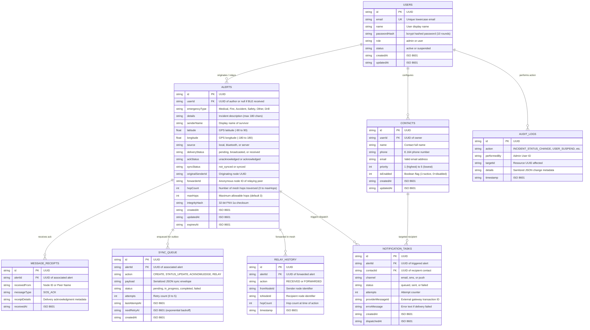

# RescueLink — Database Design & Data Architecture

**Document:** Complete Schema Specification, Storage Models & ER Diagram  
**Project:** RescueLink — Offline Bluetooth Emergency SOS System  
**Version:** 1.0.0  
**Date:** October 2026  

---

## 1. Data Architecture Strategy

RescueLink employs a hybrid data architecture optimized for resilient offline edge execution and simple, zero-dependency cloud ingestion:

1. **Client Edge Storage (SQLite):** Embedded on every mobile device using `expo-sqlite` (v15.1.4). Configured with **Write-Ahead Logging (WAL)** for ACID transactional guarantees, concurrent background reading during active writes, and versioned idempotent migrations.
2. **Cloud Backend Storage (Atomic JSON File Stores):** Stateless, concurrency-safe asynchronous JSON document stores (`users.json`, `alerts.json`, `contacts.json`, `notifications.json`, `audit_logs.json`) protected by in-memory mutex queues and atomic file renames.

---

## 2. Mermaid Entity-Relationship (ER) Diagram



---

## 3. SQLite Client Schema Specifications

### 3.1 `alerts` Table
Primary local storage for all emergency incidents composed locally, received over BLE, or fetched from the server.

```sql
CREATE TABLE IF NOT EXISTS alerts (
  id TEXT PRIMARY KEY,
  userId TEXT,
  emergencyType TEXT NOT NULL,
  details TEXT,
  senderName TEXT,
  latitude REAL,
  longitude REAL,
  source TEXT NOT NULL DEFAULT 'local',       -- 'local' | 'bluetooth' | 'server'
  deliveryStatus TEXT NOT NULL DEFAULT 'pending', -- 'pending' | 'broadcasted' | 'received'
  ackStatus TEXT NOT NULL DEFAULT 'unacknowledged', -- 'unacknowledged' | 'acknowledged'
  syncStatus TEXT NOT NULL DEFAULT 'not_synced',   -- 'not_synced' | 'synced'
  originalSenderId TEXT,
  forwarderId TEXT,
  hopCount INTEGER NOT NULL DEFAULT 0,
  maxHops INTEGER NOT NULL DEFAULT 3,
  integrityHash TEXT,
  createdAt TEXT NOT NULL,
  updatedAt TEXT NOT NULL,
  expiresAt TEXT
);

CREATE INDEX IF NOT EXISTS idx_alerts_createdAt ON alerts(createdAt);
CREATE INDEX IF NOT EXISTS idx_alerts_source ON alerts(source);
CREATE INDEX IF NOT EXISTS idx_alerts_deliveryStatus ON alerts(deliveryStatus);
CREATE INDEX IF NOT EXISTS idx_alerts_syncStatus ON alerts(syncStatus);
```

### 3.2 `message_receipts` Table
Maintains cryptographic or peer delivery receipts and responder acknowledgments.

```sql
CREATE TABLE IF NOT EXISTS message_receipts (
  id TEXT PRIMARY KEY,
  alertId TEXT NOT NULL,
  receivedFrom TEXT NOT NULL,
  messageType TEXT NOT NULL DEFAULT 'SOS_ACK',
  receiptDetails TEXT,
  receivedAt TEXT NOT NULL,
  FOREIGN KEY (alertId) REFERENCES alerts(id) ON DELETE CASCADE
);

CREATE INDEX IF NOT EXISTS idx_receipts_alertId ON message_receipts(alertId);
```

### 3.3 `sync_queue` Table
Durable outbox for opportunistic cloud synchronization, enforcing deduplication and exponential retry backoff.

```sql
CREATE TABLE IF NOT EXISTS sync_queue (
  id TEXT PRIMARY KEY,
  alertId TEXT NOT NULL,
  action TEXT NOT NULL,                       -- 'CREATE' | 'STATUS_UPDATE' | 'ACKNOWLEDGE' | 'RELAY'
  payload TEXT NOT NULL,                      -- Serialized JSON envelope
  status TEXT NOT NULL DEFAULT 'pending',     -- 'pending' | 'in_progress' | 'completed' | 'failed'
  attempts INTEGER NOT NULL DEFAULT 0,
  lastAttemptAt TEXT,
  nextRetryAt TEXT,
  createdAt TEXT NOT NULL,
  FOREIGN KEY (alertId) REFERENCES alerts(id) ON DELETE CASCADE
);

CREATE INDEX IF NOT EXISTS idx_sync_queue_status ON sync_queue(status);
CREATE INDEX IF NOT EXISTS idx_sync_queue_alertId_action ON sync_queue(alertId, action);
```

### 3.4 `relay_history` Table
Audit trail of all multi-device mesh relay interactions, tracking incoming hops and forwarded broadcasts.

```sql
CREATE TABLE IF NOT EXISTS relay_history (
  id TEXT PRIMARY KEY,
  alertId TEXT NOT NULL,
  action TEXT NOT NULL,                       -- 'RECEIVED' | 'FORWARDED'
  fromNodeId TEXT,
  toNodeId TEXT,
  hopCount INTEGER NOT NULL DEFAULT 0,
  timestamp TEXT NOT NULL,
  FOREIGN KEY (alertId) REFERENCES alerts(id) ON DELETE CASCADE
);

CREATE INDEX IF NOT EXISTS idx_relay_history_alertId ON relay_history(alertId);
CREATE INDEX IF NOT EXISTS idx_relay_history_timestamp ON relay_history(timestamp);
```

### 3.5 `contacts` Table
Secure local cache of user-configured emergency contacts.

```sql
CREATE TABLE IF NOT EXISTS contacts (
  id TEXT PRIMARY KEY,
  userId TEXT NOT NULL,
  name TEXT NOT NULL,
  phone TEXT NOT NULL,
  email TEXT NOT NULL,
  priority INTEGER NOT NULL DEFAULT 1,        -- 1 (Highest) to 5 (Lowest)
  isEnabled INTEGER NOT NULL DEFAULT 1,       -- 1 = True, 0 = False
  createdAt TEXT NOT NULL,
  updatedAt TEXT NOT NULL
);

CREATE INDEX IF NOT EXISTS idx_contacts_userId ON contacts(userId);
CREATE INDEX IF NOT EXISTS idx_contacts_priority ON contacts(priority);
```

### 3.6 `notification_tasks` Table
Persistent queue of local notification dispatch tasks.

```sql
CREATE TABLE IF NOT EXISTS notification_tasks (
  id TEXT PRIMARY KEY,
  alertId TEXT NOT NULL,
  contactId TEXT,
  channel TEXT NOT NULL,                      -- 'email' | 'sms' | 'push'
  status TEXT NOT NULL DEFAULT 'queued',      -- 'queued' | 'sent' | 'failed'
  attempts INTEGER NOT NULL DEFAULT 0,
  providerMessageId TEXT,
  errorMessage TEXT,
  createdAt TEXT NOT NULL,
  dispatchedAt TEXT,
  FOREIGN KEY (alertId) REFERENCES alerts(id) ON DELETE CASCADE
);

CREATE INDEX IF NOT EXISTS idx_notifications_alertId ON notification_tasks(alertId);
CREATE INDEX IF NOT EXISTS idx_notifications_status ON notification_tasks(status);
```

---

## 4. SQLite Migration Pipeline

Mobile database evolution is managed through sequential, versioned migrations tracked via SQLite's built-in `PRAGMA user_version`. When the mobile app initializes:

1. `user_version` is read.
2. If `user_version < TargetVersion`, pending migration scripts execute sequentially within an atomic transaction.
3. Upon successful completion, `PRAGMA user_version` is updated.

| Migration | Version | Key DDL Operations Applied |
|---|---|---|
| **v1** | `1` | Creates foundational tables: `alerts`, `message_receipts`, and `sync_queue` with performance indexes. |
| **v2** | `2` | Adds retry scheduling metadata (`lastAttemptAt`, `nextRetryAt`) and compound deduplication index `idx_sync_queue_alertId_action` to `sync_queue`. |
| **v3** | `3` | Alters `alerts` table to add mesh relay columns (`originalSenderId`, `forwarderId`, `hopCount`, `maxHops`, `integrityHash`, `expiresAt`) and creates `relay_history` table. |
| **v4** | `4` | Creates `contacts` and `notification_tasks` tables with priority and status indexes. |

---

## 5. Backend Atomic Storage Architecture

The Express.js backend utilizes high-performance, atomic asynchronous JSON storage drivers located in `server/data/`:
- `users.json`: Registered user accounts, bcrypt password hashes, and roles (`admin`, `user`).
- `alerts.json`: Centralized emergency alerts ingested from direct API calls and opportunistic mesh syncs.
- `contacts.json`: User-associated emergency contact records.
- `notifications.json`: Dispatched and queued multi-channel notification audit records.
- `audit_logs.json`: Tamper-evident administrative action ledger.

### Concurrency & Integrity Controls:
- **In-Memory Write Mutex:** Asynchronous read/write operations for each document are serialized via an internal Promise-chain mutex to prevent race conditions during concurrent HTTP requests.
- **Atomic Two-Phase Flush:** File writes are executed to a temporary file (`filename.tmp`) followed by an atomic filesystem rename (`fs.rename`), ensuring that an unexpected process crash or power loss never results in a corrupted, half-written JSON document.
