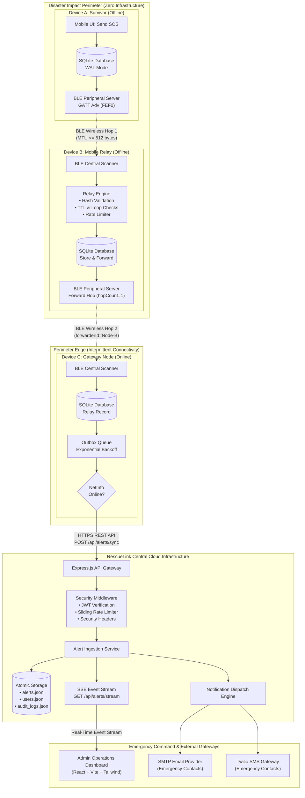
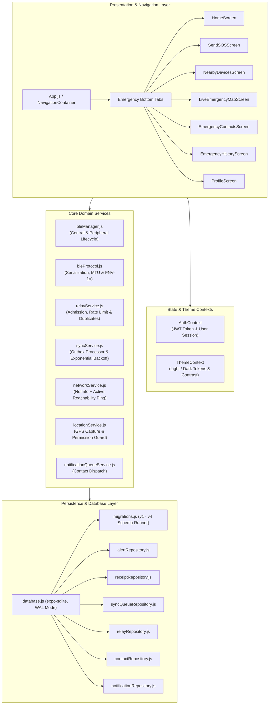
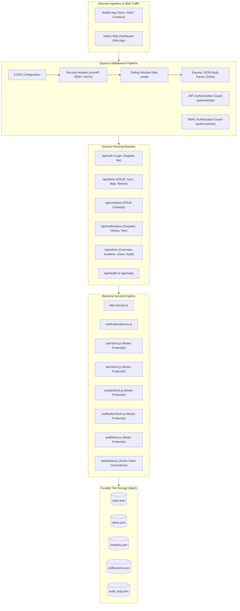
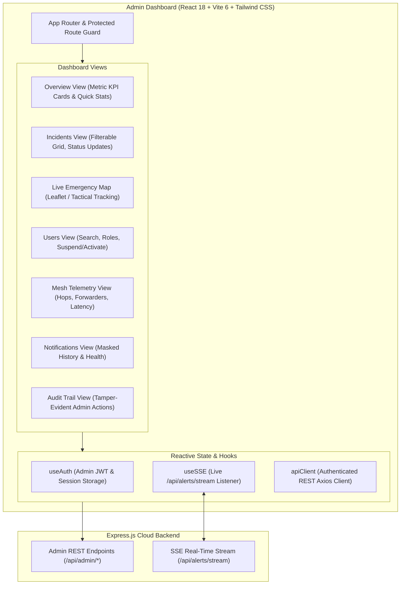
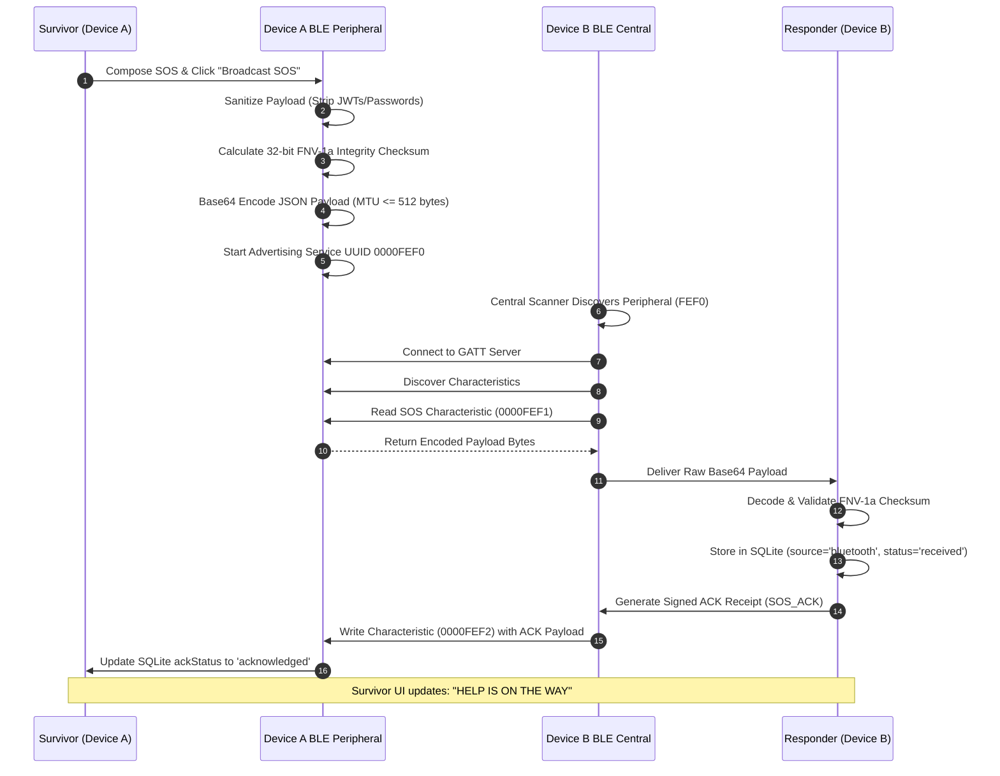
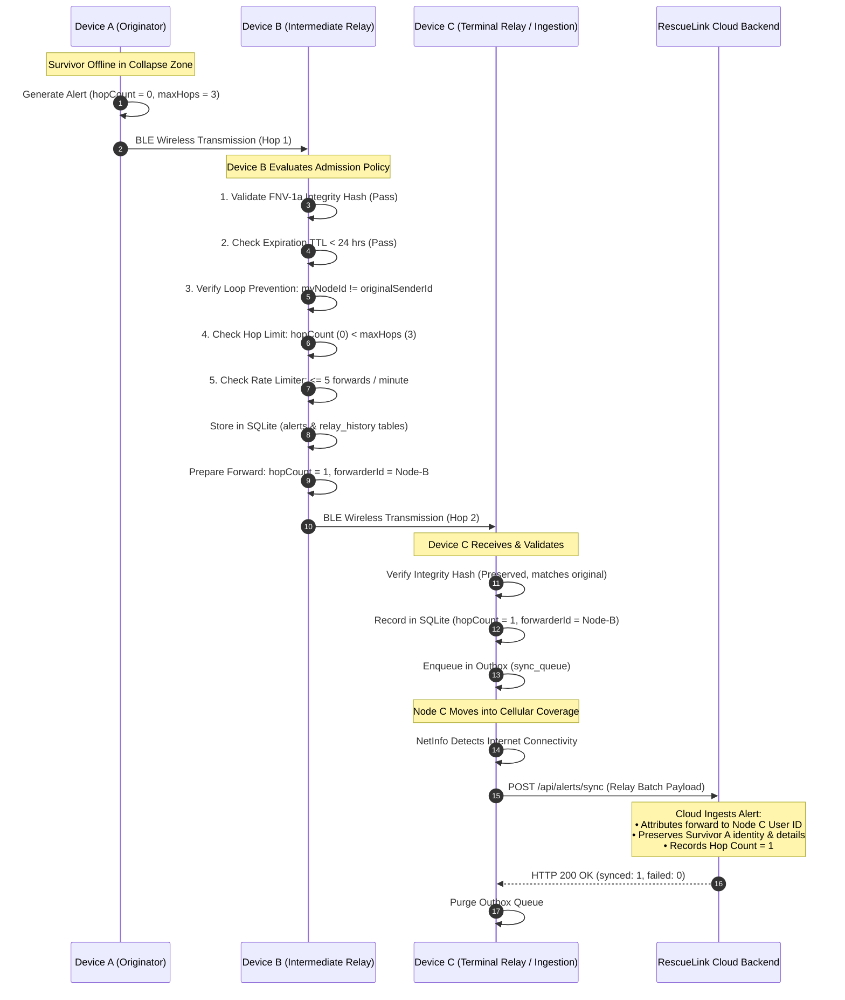
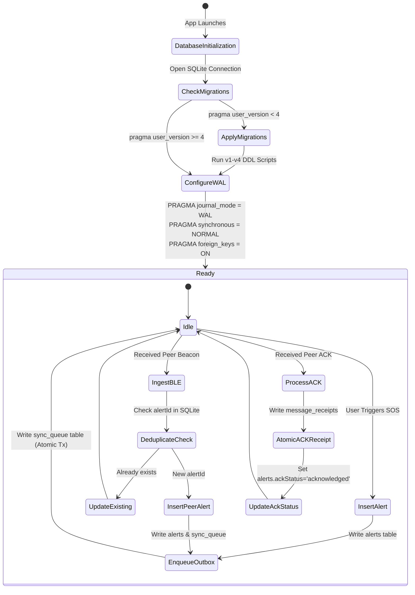
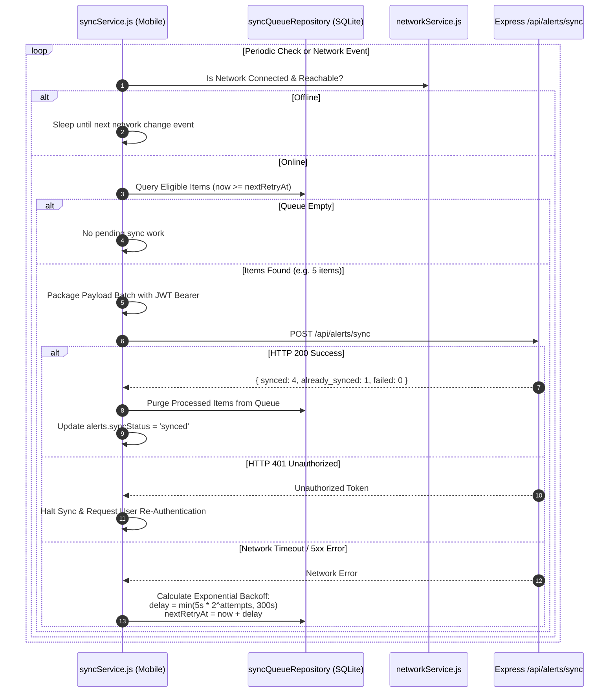
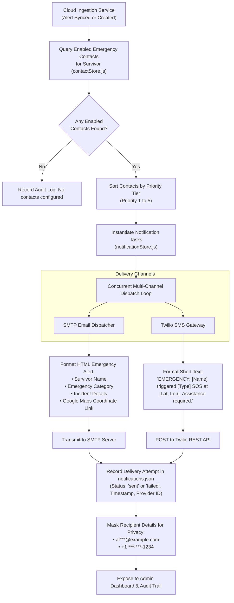
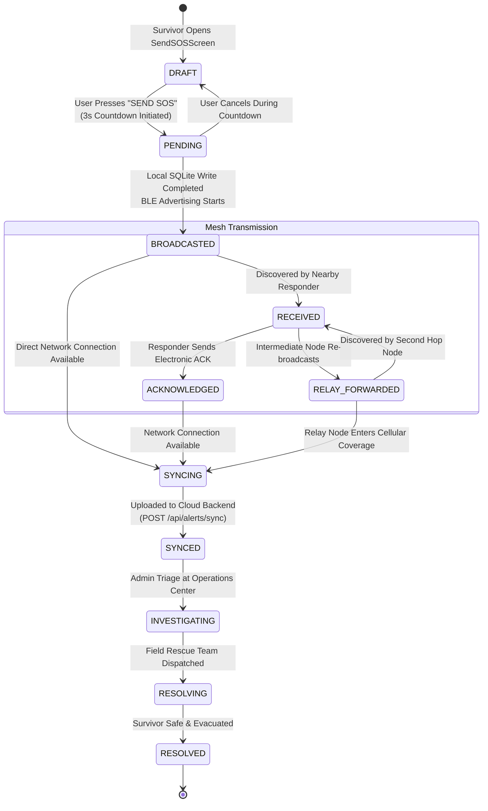

# RescueLink — System Architecture Specification

**Document:** Comprehensive System Architecture & Data Flow Guide  
**Project:** RescueLink — Offline Bluetooth Emergency SOS System  
**Version:** 1.0.0  
**Date:** October 2026  

---

## 1. System Architectural Overview

RescueLink operates as an asymmetric, distributed, store-and-forward emergency distress signaling network. The architecture is decomposed into three principal tiers:
1. **Edge Tier (Mobile Mesh Nodes):** Offline-first React Native (Expo) clients executing on civilian and responder smartphones, equipped with embedded SQLite storage, dual-mode Bluetooth Low Energy transceivers, and an autonomous epidemic relay engine.
2. **Gateway & Ingestion Tier (Express.js Backend):** High-throughput, stateless Node.js server exposing authenticated RESTful endpoints, SSE real-time broadcast streams, and atomic JSON file persistence.
3. **Command & Operations Tier (Admin Web App & Dispatch Pipelines):** Single-page operations dashboard (React 18, Vite 6, Tailwind CSS) providing live situational telemetry, spatial mapping, and automated SMTP/SMS notification dispatch to emergency contacts.

---

## 2. Diagram 1: Overall System Architecture

The following diagram illustrates the complete end-to-end topology of RescueLink across offline mesh boundaries and cloud-connected command facilities:

---

## 3. Diagram 2: Mobile Application Architecture

The mobile client is engineered with clean layer separation, decoupling presentation logic from background hardware and persistence services:

---

## 4. Diagram 3: Backend Architecture

The backend architecture is built with Node.js and Express.js, featuring layered separation of concerns, concurrency-safe atomic file stores, and event-driven broadcasting:

---

## 5. Diagram 4: Admin Dashboard Architecture

The Admin Dashboard provides a real-time reactive command-and-control interface for emergency operators:

---

## 6. Diagram 5: BLE SOS Communication Flow

The physical over-the-air communication lifecycle between an originating device and a nearby receiver node:

---

## 7. Diagram 6: Multi-Device Relay Workflow

The controlled epidemic routing mechanism forwarding emergency packets across multiple disconnected devices:

---

## 8. Diagram 7: SQLite Offline Storage Workflow

The transactional storage lifecycle ensuring Write-Ahead durability and migration consistency:

---

## 9. Diagram 8: Cloud Synchronization Workflow

The opportunistic synchronization pipeline utilizing exponential backoff retry scheduling:

---

## 10. Diagram 9: Emergency Notification Workflow

The automated multi-channel contact notification engine triggered upon alert synchronization:

---

## 11. Diagram 10: SOS Incident Lifecycle

The complete state transition graph of an emergency incident from survivor trigger to final resolution:

