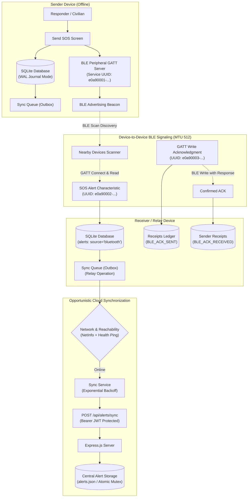

# RescueLink Architecture & Technical Specification

## 1. System Overview

**RescueLink** is an offline-first emergency distress signaling and peer-to-peer relay system. In disaster scenarios, power grid failures, and remote wilderness areas where cellular and broadband networks fail, RescueLink enables mobile devices to persist emergency beacons in local SQLite storage, broadcast distress signals over custom Bluetooth Low Energy (BLE) GATT profiles, exchange peer acknowledgments, and opportunistically relay distress data to the central cloud once connectivity is restored.

---

## 2. Complete Data Flow

1. **SOS Creation & Offline Persistence**:
   - The user selects an emergency category (`Medical Emergency`, `Accident`, `Personal Safety`, `Fire`, `Other`, or `Test / Drill`).
   - The user optionally consents to attach GPS coordinates.
   - The alert is immediately saved into SQLite (`alerts` table) with:
     - `source = 'local'`
     - `deliveryStatus = 'pending'`
     - `ackStatus = 'unacknowledged'`
     - `syncStatus = 'pending_sync'`
   - If the backend is unreachable or offline, an operation is enqueued into the `sync_queue` table.

2. **BLE Broadcast (Sender)**:
   - The user activates "Broadcast via Bluetooth".
   - The GATT server initializes the custom 128-bit service (`e0a90001-b5a3-f393-e0a9-e50e24dcca9e`).
   - The alert payload is serialized to Base64 (sanitized, max 512 bytes MTU).
   - The device advertises its availability.

3. **BLE Discovery & Reception (Receiver)**:
   - A nearby peer running RescueLink scans for `e0a90001-...`.
   - The receiver discovers the sender with real RSSI metrics.
   - The receiver connects, reads `e0a90002-...`, and deserializes the distress beacon.
   - The alert is persisted into the receiver's SQLite with `source = 'bluetooth'` and `deliveryStatus = 'received'`.
   - The receiver enqueues the alert in their local `sync_queue` to act as an opportunistic cloud relay.

4. **BLE Acknowledgment**:
   - The receiver writes `SOS_ACK` to `e0a90003-...` with confirmation.
   - The receiver records a receipt in `message_receipts` (`receiptType = 'BLE_ACK_SENT'`).
   - The sender receives confirmation, records a receipt (`receiptType = 'BLE_ACK_RECEIVED'`), and atomically updates `alerts.ackStatus = 'acknowledged'`.

5. **Opportunistic Cloud Synchronization**:
   - When either device re-establishes internet connectivity, `networkService` detects reachability.
   - `syncService` processes eligible outbox items in batches of 10.
   - Payloads are submitted to `POST /api/alerts/sync` with Bearer JWT authentication.
   - The server validates data, enforces idempotency using stable `alertId`s, and assigns proper relay attribution.
   - Upon confirmation, local SQLite records are updated to `syncStatus = 'synced'` and deleted from `sync_queue`.

---

## 3. State & Data Consistency Model

RescueLink maintains strict separation between independent physical and transport states:

| State Variable | Table / Field | Allowed Values | Semantic Meaning |
|---|---|---|---|
| **Delivery Status** | `alerts.deliveryStatus` | `'pending'`, `'received'`, `'Resolved'` | Progress of incident resolution. Sender sets Pending; receiver sets Received; either party can mark Resolved. |
| **Acknowledgment Status** | `alerts.ackStatus` | `'unacknowledged'`, `'acknowledged'` | Direct peer-to-peer confirmation over BLE. Never marked acknowledged until GATT confirmation is received. |
| **Sync Status** | `alerts.syncStatus` | `'pending_sync'`, `'synced'`, `'not_synced'` | Cloud backend synchronization state. Independent of BLE delivery or acknowledgment. |
| **Source Attribution** | `alerts.source` | `'local'`, `'bluetooth'`, `'server'` | Physical origin of alert. Distinguishes self-authored alerts from peer-relayed beacons. |
| **Outbox Queue State** | `sync_queue.status` | `'pending'`, `'processing'`, `'failed'` | Cloud dispatch queue state. Controlled by concurrency locks and exponential backoff timers. |

> [!WARNING]
> **Safety Invariant**: RescueLink never treats "saved locally" or "sent over BLE" as "delivered to emergency services". Unless a certified dispatch hotlink is explicitly verified, the app displays: *"Local / Mesh transmission only. Official emergency services (911/112) have NOT been contacted."*

---

## 4. Security Architecture & Threat Mitigation

### 4.1 Credential & Token Isolation
- Plaintext passwords, bcrypt hashes, and JWT tokens are **never** included in BLE messages or logged.
- The `sanitizeBLEPayload()` utility sanitizes all outgoing and incoming characteristics.

### 4.2 Bluetooth Protocol Boundaries
- **512-Byte MTU Hard Limit**: Prevents buffer overflows and packet fragmentation.
- **Malformed Message Resilience**: `deserializeBLEMessage()` catches invalid JSON or corrupted Base64 and returns `{ valid: false }` without crashing the application.
- **Duplicate Message Filtering**: Receiving the same `alertId` multiple times over BLE updates the existing record rather than generating redundant incident reports.

### 4.3 Relay Attribution Model
- When an authenticated user relays an alert received over BLE, the backend marks:
  - `source = 'bluetooth_relay'`
  - `relayedBy = req.user.id` (Authenticated uploader)
  - `relayedByName = req.user.name`
  - `senderName = originalSenderName` (Preserves original peer identity)
- This prevents peer impersonation and maintains forensic integrity.

### 4.4 Known Architectural Limitations
1. **Unencrypted BLE Advertisements**: BLE GATT characteristics in this prototype are unencrypted at the Bluetooth radio layer to permit universal discovery across non-paired devices. Production deployments should implement end-to-end Curve25519 public key cryptography.
2. **Replay Attacks**: A malicious node could rebroadcast a captured BLE beacon. Mitigated in RescueLink via stable `alertId` deduplication in SQLite and on the server.
3. **Physical Range**: BLE Class 2 range is nominally 10–30 meters line-of-sight and decreases through reinforced walls or physical barriers.
