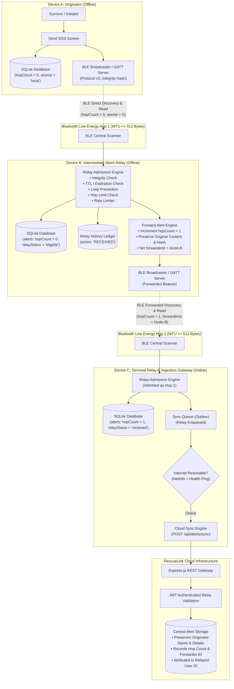

# RescueLink Architecture & Technical Specification

## 1. System Overview

**RescueLink** is an offline-first emergency distress signaling, peer-to-peer relay, and cloud-synchronization system. In disaster scenarios, power grid failures, and remote wilderness areas where cellular and broadband networks fail, RescueLink enables mobile devices to persist emergency beacons in local SQLite storage, broadcast distress signals over custom Bluetooth Low Energy (BLE) GATT profiles, exchange peer acknowledgments, form multi-device mesh forwarding paths, and opportunistically relay distress data to the central cloud once connectivity is restored.

---

## 2. Multi-Device SOS Relay Network Architecture (Step 8)

RescueLink implements a controlled, multi-device epidemic forwarding protocol designed specifically for zero-infrastructure emergency communications. When Device A (the originator) has no cellular coverage, it broadcasts an SOS beacon over Bluetooth Low Energy. Device B discovers and records the beacon, and acting as an intermediate relay hop, forwards it over BLE to Device C. When any device in the relay chain (such as Device C) regains internet access, the distress alert is automatically synchronized with the central cloud backend.



---

## 3. Message Protocol Specification (Version 2)

RescueLink uses a compact, versioned JSON message structure Base64-encoded to fit within standard 512-byte BLE characteristic Maximum Transmission Units (MTU).

### 3.1 SOS_ALERT Payload Schema
```json
{
  "version": 2,
  "type": "SOS_ALERT",
  "alertId": "550e8400-e29b-41d4-a716-446655440000",
  "emergencyType": "Medical Emergency",
  "details": "Compound fracture on ridge trail. Bleeding controlled.",
  "senderName": "Alice Survivor",
  "latitude": 37.7749,
  "longitude": -122.4194,
  "createdAt": "2026-10-30T10:00:00.000Z",
  "expiresAt": "2026-10-31T10:00:00.000Z",
  "originalSenderId": "user-uuid-device-a",
  "forwarderId": "node-7b8c2d",
  "hopCount": 1,
  "maxHops": 3,
  "integrityHash": "4a7f9c2e"
}
```

### 3.2 Protocol Fields Definition
| Field | Type | Description | Mutable by Relay? |
|---|---|---|---|
| `version` | Integer | Protocol specification version (`1` or `2`). | No |
| `type` | String | Fixed message identifier (`SOS_ALERT` or `SOS_ACK`). | No |
| `alertId` | String (UUID) | Immutable unique identifier generated at origin. | No |
| `emergencyType` | String | Category: Medical, Accident, Personal Safety, Fire, Other, Test / Drill. | No |
| `details` | String | Plaintext description bounded to 180 characters. | No |
| `senderName` | String | Survivor display name bounded to 40 characters. | No |
| `latitude` | Number \| null | GPS latitude (4-decimal precision, -90 to 90). | No |
| `longitude` | Number \| null | GPS longitude (4-decimal precision, -180 to 180). | No |
| `createdAt` | String (ISO) | Original alert timestamp at creation. | No |
| `expiresAt` | String (ISO) | Message expiration timestamp (default `createdAt` + 24 hours). | No |
| `originalSenderId`| String \| null | Cryptographic or user identifier of the original author. | No |
| `integrityHash` | String (8 hex) | Deterministic FNV-1a checksum of all immutable fields. | **NEVER** |
| `forwarderId` | String | Anonymous node identifier of the forwarding device (`node-XXXXXX`). | **Yes (Updated by forwarder)** |
| `hopCount` | Integer | Number of network hops completed so far (0 at origin). | **Yes (Incremented by forwarder)** |
| `maxHops` | Integer | Maximum permissible hop limit (default 3, range 1–5). | No |

### 3.3 Cryptographic Content Integrity Validation
To guarantee that forwarders never modify distress coordinates, emergency categories, or details in transit, `computeAlertIntegrityHash` calculates a 32-bit FNV-1a checksum across the normalized immutable fields:
$$\text{Content} = \text{alertId} \parallel \text{emergencyType} \parallel \text{details} \parallel \text{lat} \parallel \text{lon} \parallel \text{createdAt} \parallel \text{originalSenderId}$$

Every intermediate node validates `verifyAlertIntegrity(alert)`. If a forwarding node alters the distress message, coordinates, or emergency type, the hash check fails immediately with `INTEGRITY_MISMATCH`, and the tampered packet is dropped.

---

## 4. Relay Admission Controls & Safeguards

To prevent Denial of Service (DoS), infinite routing loops, and radio congestion, `relayService` executes a multi-stage admission pipeline:

1. **Integrity Validation**: Rejects any message where calculated checksum does not match `integrityHash`.
2. **Expiration Enforcement (TTL)**: Compares `expiresAt` with system clock. Expired alerts are dropped (`EXPIRED`).
3. **Loop Prevention**:
   - Rejects alerts originating from own user ID or own node ID (`LOOP_DETECTED`).
   - Rejects alerts where `forwarderId` matches own node ID (`LOOP_PREVIOUS_FORWARDER`).
   - Rejects alerts already forwarded by this node via SQLite `relay_history` query (`ALREADY_FORWARDED`).
4. **Duplicate Detection**:
   - If `alertId` already exists in SQLite with equal or lower hop count, further re-broadcasts are suppressed (`DUPLICATE_ALERT`).
5. **Relay Enabled Switch**:
   - Responders can toggle "SOS Mesh Relay" in Profile settings.
   - When disabled, incoming alerts are saved locally for personal triage and queued for cloud sync, but **not** forwarded over BLE (`RELAY_DISABLED`).
6. **Maximum Hop Limit Enforcement**:
   - Clamped between 1 and 5 (default 3). If `hopCount >= maxHops`, forwarding is suppressed (`HOP_LIMIT_REACHED`).
7. **Sliding-Window Rate Limiting**:
   - Maximum 5 forward broadcasts per 60-second sliding window (`RATE_LIMIT_EXCEEDED`). Protects radio saturation and battery exhaustion.

---

## 5. SQLite Schema & Migrations

RescueLink uses version-tracked migrations applied via `PRAGMA user_version`:

### Migration v1 (Step 5)
- `alerts`: Core emergency distress records table.
- `message_receipts`: Delivery and acknowledgment receipts table.
- `sync_queue`: Offline outbox queue table.

### Migration v2 (Step 6)
- Adds exponential backoff scheduling (`lastAttemptAt`, `nextRetryAt`) and unique constraints (`idx_sync_queue_alert_op`) to `sync_queue`.

### Migration v3 (Step 8 — Multi-Device Relay)
- Extends `alerts` table with relay metadata:
  ```sql
  ALTER TABLE alerts ADD COLUMN hopCount INTEGER DEFAULT 0;
  ALTER TABLE alerts ADD COLUMN maxHops INTEGER DEFAULT 3;
  ALTER TABLE alerts ADD COLUMN forwarderId TEXT;
  ALTER TABLE alerts ADD COLUMN originalSenderId TEXT;
  ALTER TABLE alerts ADD COLUMN expiresAt TEXT;
  ALTER TABLE alerts ADD COLUMN relayStatus TEXT DEFAULT 'none';
  ALTER TABLE alerts ADD COLUMN lastForwardedAt TEXT;
  ALTER TABLE alerts ADD COLUMN integrityHash TEXT;
  ```
- Creates `relay_history` table for immutable auditing:
  ```sql
  CREATE TABLE IF NOT EXISTS relay_history (
    id INTEGER PRIMARY KEY AUTOINCREMENT,
    alertId TEXT NOT NULL,
    action TEXT NOT NULL CHECK(action IN ('RECEIVED', 'FORWARDED', 'DROPPED')),
    hopCount INTEGER NOT NULL DEFAULT 0,
    forwarderId TEXT,
    previousHopId TEXT,
    statusReason TEXT,
    timestamp TEXT NOT NULL,
    metadata TEXT
  );

  CREATE INDEX IF NOT EXISTS idx_relay_history_alert_id ON relay_history(alertId);
  CREATE INDEX IF NOT EXISTS idx_relay_history_action ON relay_history(action);
  CREATE INDEX IF NOT EXISTS idx_relay_history_timestamp ON relay_history(timestamp DESC);
  ```

---

## 6. BLE Capabilities & Realistic Android Hardware Nuances

| Capability | Supported in React Native `react-native-ble-plx`? | Supported in Android Native SDK? | Implementation in RescueLink |
|---|---|---|---|
| **BLE Central (Scanning & GATT Client)** | ✅ Full Support | ✅ Full Support | `bleCentralService.js` scans for `e0a90001-...`, connects, requests 512 MTU, reads SOS characteristic, writes ACK. |
| **BLE Peripheral (GATT Server & Advertising)** | ❌ Not supported by `react-native-ble-plx` | ✅ Supported via `BluetoothLeAdvertiser` & `BluetoothGattServer` | Handled via `blePeripheralService.js` using `react-native-ble-peripheral` native bridge in Expo Dev Builds (`npx expo run:android`), with clear fallback reports in Expo Go. |
| **Multi-Hop Relay Forwarding** | Supported in hybrid Central/Peripheral mode | Supported via simultaneous multi-role BLE | Central receives SOS, persists to SQLite, triggers Peripheral advertising with incremented hop count. |

> [!NOTE]
> Android 12+ requires runtime permissions: `BLUETOOTH_SCAN`, `BLUETOOTH_CONNECT`, and `BLUETOOTH_ADVERTISE`. Android hardware must support multiple advertising (`BluetoothAdapter.isMultipleAdvertisementSupported()`).

---

## 7. Comprehensive Automated Test Matrix (35 Tests)

The test runner (`tests/run-all-tests.mjs`) exercises all 6 core subsystems in pure Node.js with in-memory SQLite and ephemeral Express servers:

1. **Module 1**: Authentication, JWT & Security (6 tests)
2. **Module 2**: Emergency Alert REST API & Validation (5 tests)
3. **Module 3**: BLE Protocol & Sanitization (3 tests)
4. **Module 4**: SQLite Offline Persistence & Migrations v1–v3 (4 tests)
5. **Module 5**: Offline Outbox & Cloud Synchronization (7 tests)
6. **Module 6**: Multi-Device SOS Relay Network (10 tests)
   - Valid relay message serialization & integrity hashing
   - Content tampering detection via checksum mismatch
   - Expiration / TTL rejection
   - Duplicate alert detection & idempotency
   - Maximum hop count enforcement
   - Loop prevention (own-origin and previous forwarder)
   - Relay disabled setting enforcement
   - Sliding-window rate limiting
   - SQLite relay-history persistence & aggregate stats
   - Three-device multi-hop simulation with backend cloud sync
